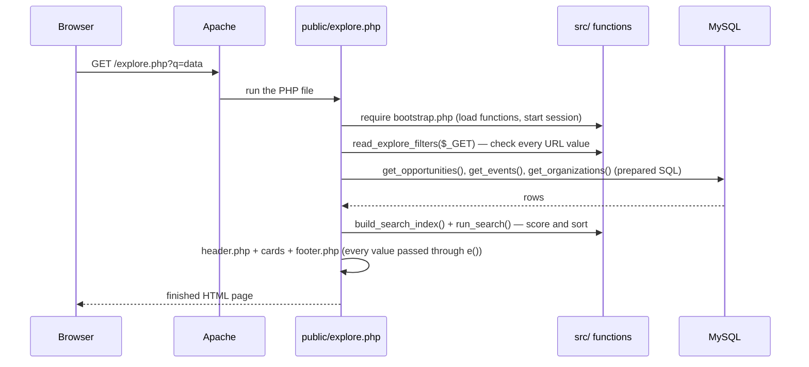
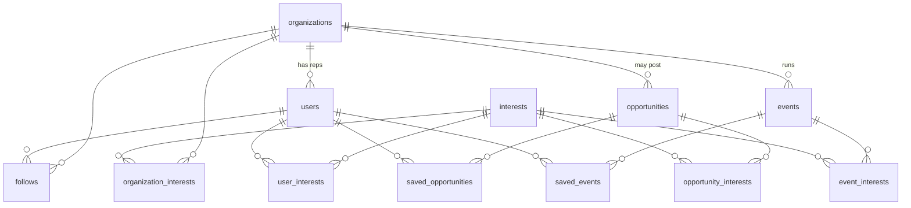

# CampusBridge

**Every campus opportunity, one bridge away.**

CampusBridge is a web application that brings **scholarships, internships, campus events and
student organizations** into one place. Students get **recommendations that explain themselves**,
**deadline tracking** and a **calendar that warns about clashing events**. Organization
representatives publish events, and administrators review new listings before they go public.

It is built with **plain PHP 8 and MySQL 8**, with no framework, and runs on **AMPPS** or **Docker**.

> **Independent student project.** CampusBridge is a CS341 Web Technologies project. It is not
> affiliated with, endorsed by or operated by Ashesi University or any other institution. All
> organizations, opportunities and events in the sample database are **fictional**.

---

## Contents

1. [What CampusBridge does](#1-what-campusbridge-does)
2. [Academic context](#2-academic-context)
3. [Features and status](#3-features-and-status)
4. [Run it with Docker](#4-run-it-with-docker)
5. [Run it with AMPPS](#5-run-it-with-ampps)
6. [Demo accounts](#6-demo-accounts)
7. [How the code is organized](#7-how-the-code-is-organized)
8. [The database](#8-the-database)
9. [Security](#9-security)
10. [Testing](#10-testing)
11. [Team collaboration](#11-team-collaboration)
12. [Viva quiz preparation: concepts and tech stack explained](#12-viva-quiz-preparation)
13. [Presentation and demo plan](#13-presentation-and-demo-plan)
14. [Submission checklist](#14-submission-checklist)
15. [AI assistance and academic responsibility](#15-ai-assistance-and-academic-responsibility)
16. [Known limitations](#16-known-limitations)
17. [License](#17-license)

---

## 1. What CampusBridge does

### The problem (our hypotheses, not yet verified)

| #   | Hypothesis                                                                         |
| --- | ---------------------------------------------------------------------------------- |
| H1  | Opportunities are scattered across email, group chats and posters.                 |
| H2  | Students miss scholarship and internship deadlines because they find out too late. |
| H3  | Club events are hard to discover outside a student's own friend group.             |
| H4  | Students struggle to tell which opportunities fit their interests.                 |

**How to check them:** run a short survey (30+ students) and five 10-minute interviews, one per
team member. Ask where students hear about opportunities, whether they missed a deadline last
semester, and whether explained recommendations would increase their trust. Report the real
numbers, including any that do not support the hypotheses. Do not collect names or student IDs
without consent.

### The solution

- **One search** across opportunities, events and organizations, with filters.
- **Explainable recommendations**: a points system that shows *why* each item is suggested.
- **Deadline tracking**: saved opportunities grouped by urgency (today, this week, …).
- **Calendar with clash detection**, plus export to Outlook, Google Calendar or Apple Calendar (`.ics`).
- **Roles**: students, organization representatives and administrators, each with their own pages.

### Users

| Role                            | Can do                                                                         |
| ------------------------------- | ------------------------------------------------------------------------------ |
| Guest                           | Browse and search everything that is published.                                |
| Student                         | Everything above, plus choose interests, save items, follow clubs, see the dashboard and calendar. |
| Organization representative     | Everything a student can do, plus create, edit and delete **their own organization's** events. |
| Administrator                   | Everything a student can do, plus approve or reject new listings and see analytics. |

---

## 2. Academic context

- **Course:** CS341 Web Technologies, Ashesi University. Five-member group project.
- **Deliverables:** a 15-minute video (OneDrive link on Canvas) and a public GitHub repository (link on klenam.ai).

These weights come from the team's summary of the brief. **Check them against the official PDF.**

| Criterion                         | Weight | How CampusBridge addresses it                                                                                                 |
| --------------------------------- | ------ | ----------------------------------------------------------------------------------------------------------------------------- |
| Usefulness                        | 10%    | A real student problem, a plan to validate it, and features students act on (save, track, export).                             |
| Production-grade engineering      | 15%    | Real accounts with hashed passwords, server-side role checks, prepared statements, CSRF protection, validation, error pages, responsive design, 77 automated tests, CI. |
| Ambition and technical complexity | 25%    | Search engine with typo tolerance, explainable recommender, clash detection algorithm, `.ics` export, review workflow, analytics. |
| Individual viva quiz              | 50%    | Plain PHP with no framework "magic", heavily commented code, and the [viva guide](#12-viva-quiz-preparation).                  |

---

## 3. Features and status

✅ = implemented and tested · 📋 = planned

| Feature                                   | Status | Where                                         |
| ----------------------------------------- | ------ | --------------------------------------------- |
| Home page with search and highlights      | ✅     | `public/index.php`                            |
| Unified search, filters and sorting       | ✅     | `public/explore.php`, `src/search.php`        |
| Opportunity, event and organization pages | ✅     | `public/opportunity.php`, `event.php`, `organization.php` |
| Events by day, organizations by category  | ✅     | `public/events.php`, `organizations.php`      |
| Accounts: sign up, sign in, sign out      | ✅     | `public/register.php`, `login.php`, `logout.php`, `src/auth.php` |
| Interests and recommendations             | ✅     | `public/preferences.php`, `dashboard.php`, `src/recommend.php` |
| Save, "I'm interested" and follow         | ✅     | `public/toggle.php`                           |
| Deadline tracker                          | ✅     | `public/saved.php`, `src/deadlines.php`       |
| Calendar with clash detection             | ✅     | `public/calendar.php`, `src/schedule.php`     |
| Calendar export (`.ics`)                  | ✅     | `public/calendar-export.php`, `src/ics.php`   |
| Org rep: create, edit, delete own events  | ✅     | `public/manage.php`, `manage-event.php`, `manage-event-delete.php` |
| Admin: review queue with automated hints  | ✅     | `public/admin.php`, `admin-review.php`, `src/moderation.php` |
| Admin: analytics charts                   | ✅     | `public/admin.php`, `src/analytics.php`       |
| Cross-campus: events for everyone or one campus only | ✅ | `src/data/campuses.php`, `src/data/events.php`, `manage-event.php` |
| Student resources with IP declaration     | ✅     | `public/resources.php`, `resource-upload.php`, `resource-download.php`, `src/data/resources.php` |
| Org rep: publish, reject, take down resources | ✅ | `public/manage.php`, `manage-resource.php`    |
| Background privacy & copyright scanner    | ✅     | `bin/scan-worker.php`, `src/resource_scan.php` |
| Deadline reminder emails                  | 📋     | Needs an email service                        |
| Password reset by email                   | 📋     | Needs an email service                        |
| Event registration with capacity limits   | 📋     | "I'm interested" is a bookmark, not a reservation |

---

## 4. Run it with Docker

The easiest option: one command starts the website, MySQL, phpMyAdmin and the resource scan worker.

**Requirements:** [Docker Desktop](https://www.docker.com/products/docker-desktop/).

```bash
git clone https://github.com/Tanseychuong/campus_bridge.git
cd campus_bridge
docker compose up --build
```

| Open                    | What                                                    |
| ----------------------- | ------------------------------------------------------- |
| http://localhost:8080   | CampusBridge                                            |
| http://localhost:8081   | phpMyAdmin (user `root`, password `campusbridge-dev`)  |

- The first start imports `database/schema.sql` and `database/seed.sql` automatically.
- Your code is shared with the container, so edits appear when you refresh the page.
- The `worker` service scans uploaded resources in the background. See what it is doing with
  `docker compose logs -f worker`. After changing scanner code, restart it: `docker compose restart worker`.
- **Reset the database** (for example to refresh the sample dates): `docker compose down -v`, then `docker compose up`.
- Stop everything: `docker compose down`.

---

## 5. Run it with AMPPS

**Requirements:** [AMPPS](https://ampps.com/) with PHP 8.2 and MySQL 8.

1. **Copy the project** into the AMPPS web folder, for example `C:\Program Files\Ampps\www\campus_bridge`
   (or clone it there with Git).
2. **Start Apache and MySQL** in the AMPPS control panel.
3. **Create the database:** open http://localhost/phpmyadmin, click **New**, name it `campus_bridge`,
   and choose collation `utf8mb4_unicode_ci`.
4. **Import the tables, then the data:** select the `campus_bridge` database, open **Import**, and import
   `database/schema.sql` first, then `database/seed.sql`.
5. **Set your MySQL password** if it is not the AMPPS default (`mysql`): copy
   `src/config.local.example.php` to `src/config.local.php` and enter your password. This file is
   git-ignored, so your password is never pushed.
6. Open **http://localhost/campus_bridge/public/**. Opening http://localhost/campus_bridge/ also redirects there.
7. **Start the scan worker** in a terminal in the project folder: `php bin/scan-worker.php` (leave it
   running). Without it, uploaded resources stay at "check in progress". For a one-off run use
   `php bin/scan-worker.php --once`. Reading Office files needs PHP's `zip` extension (enable it in AMPPS's
   PHP settings); without it the scanner asks the rep to check those files by eye. For uploads up to 10 MB,
   set `upload_max_filesize = 10M` and `post_max_size = 12M` in AMPPS's PHP settings.

**Troubleshooting**

- *"CampusBridge could not connect to its database"*: MySQL is not running, the database is not
  imported, or the password in `config.local.php` is wrong.
- *Sample dates look old*: the sample dates are relative to the day you imported `seed.sql`.
  Re-import both files to refresh them.
- To see detailed errors while developing, set `'debug' => true` in `src/config.local.php`.

---

## 6. Demo accounts

These exist only in the sample data. The password for all of them is **`CampusBridge2026!`**.

| Email                   | Role                                            |
| ----------------------- | ----------------------------------------------- |
| `student@example.org`   | Student, Hillside Campus                        |
| `riverside@example.org` | Student, Riverside Campus                       |
| `rep@example.org`       | Organization rep for *Code & Circuits Society* (organization 1, Hillside) |
| `rep2@example.org` … `rep16@example.org` | Rep for organization 2 … 16 (e.g. `rep9@example.org` = *Open Design Studio*, Riverside) |
| `admin@example.org`     | Administrator (sees every campus)               |

**Campuses.** Every organization and student belongs to a campus. When an organizer creates an event
they choose **Everyone (all campuses)** or **Only students on our campus**. Campus-only events are
filtered out in SQL (`event_visibility_condition()`), so they never reach guests or other campuses —
try *Inter-Year Football Tournament* as the Hillside vs the Riverside student.

**Resources.** Students share files on **Resources → Share a resource** and sign an intellectual-property
declaration (who created it, credits, licence, three confirmations and a typed signature). The file is
stored outside `public/` (`storage/uploads/`) under a random name and stays private until the rep of the
chosen organization publishes it on their **Manage** page. Reps can take a public resource down, and
publish it again, at any time. Uploads are limited to 10 MB and the file type is checked from its content.

**Automatic privacy & copyright check.** A background worker (`bin/scan-worker.php`) picks up every new
upload, reads its text (TXT/MD, PDF, Word, PowerPoint, Excel and text files inside ZIPs) and shows the rep
what to look at before publishing. Like the admin review hints, it never decides by itself.

| Looks for | Examples |
| --------- | -------- |
| **Privacy** | Ghana Card / passport numbers, bank card numbers (Luhn check), lists of emails or phone numbers, student IDs, dates of birth, passwords, health, bank and grade details |
| **Copyright** | Publisher notices and ISBNs (pages copied from a textbook), someone else's © notice when the student declared sole ownership, answer keys / solutions manuals / exam papers, "do not distribute" notices, a different author in the file's properties, the identical file already uploaded by another student |
| **Check by eye** | Images and scanned PDFs, which cannot be read as text |

Findings never repeat the personal data (emails are shown as `e***@example.org`), and **Publish** asks for
confirmation when a serious issue was found.

Anyone can also create a new student account on the **Create account** page. Organization reps
and admins are assigned in the database (`users.role` and `users.organization_id`).
**Delete or change these demo accounts before any real use.**

---

## 7. How the code is organized

```
campus_bridge/
├── public/                  ← the ONLY folder the web server shows to browsers
│   ├── index.php            home page
│   ├── explore.php          search
│   ├── opportunity.php      one opportunity (?id=…)
│   ├── event.php            one event (?id=…)
│   ├── organization.php     one organization (?id=…)
│   ├── events.php           events grouped by day
│   ├── organizations.php    organization directory
│   ├── login.php / register.php / logout.php
│   ├── dashboard.php / saved.php / calendar.php / calendar-export.php / preferences.php
│   ├── toggle.php           handles Save / I'm interested / Follow buttons
│   ├── manage.php / manage-event.php / manage-event-delete.php   (org reps)
│   ├── admin.php / admin-review.php                              (admins)
│   ├── about.php / not-found.php
│   └── assets/              app.css, app.js, icon.svg
├── src/                     PHP functions (no HTML)
│   ├── bootstrap.php        loaded first by every page
│   ├── config.php           settings (database, time zone)
│   ├── database.php         PDO connection + fetch_all / fetch_one / execute
│   ├── helpers.php          e(), url(), redirect(), flash messages, reading input
│   ├── security.php         sessions, CSRF tokens, security headers
│   ├── auth.php             sign in/out, current_user(), require_role()
│   ├── taxonomy.php         category and interest labels
│   ├── dates.php            time-zone-aware date helpers
│   ├── deadlines.php        urgency buckets for deadlines
│   ├── schedule.php         clash detection
│   ├── recommend.php        the recommendation rules
│   ├── search.php           the search engine and filters
│   ├── ics.php              calendar export
│   ├── moderation.php       review hints for admins
│   ├── analytics.php        numbers for the charts
│   ├── validation.php       form checking
│   └── data/                ALL SQL lives here: organizations, opportunities, events, users, interests
├── templates/               shared HTML: header, footer, cards, error pages
├── database/
│   ├── schema.sql           creates the tables
│   └── seed.sql             fictional sample data + demo accounts
├── tests/
│   ├── Unit/                tests for the logic (no database needed)
│   ├── Feature/             tests that run the real website against a test database
│   └── Support/             test helpers
├── docker/Dockerfile        the Apache + PHP image
├── docker-compose.yml       website + MySQL + phpMyAdmin
├── composer.json            only needed for running the tests (PHPUnit)
└── .github/workflows/ci.yml automatic checks on GitHub
```

### The life of one request

What happens when someone opens `explore.php?q=data`:



Every page follows the same simple pattern:

```php
<?php
require __DIR__ . '/../src/bootstrap.php';   // 1. load everything
$user = require_login();                      // 2. check who is allowed (if needed)
$events = get_events();                       // 3. get data
$pageTitle = 'Campus events';
require __DIR__ . '/../templates/header.php'; // 4. print the page
?>
<h1>…</h1>
<?php require __DIR__ . '/../templates/footer.php'; ?>
```

Forms that **change** data use **Post/Redirect/Get**: the form POSTs to a PHP file, which checks
the CSRF token and permissions, updates the database, sets a flash message and redirects to a
normal page.

---

## 8. The database



- **Main tables:** `organizations`, `opportunities`, `events`, `users`, `interests`.
- **Join tables** (many-to-many): `*_interests`, `saved_opportunities`, `saved_events`, `follows`.
  Their primary key is the pair of ids, so the same item cannot be saved twice.
- **Status column:** `published`, `pending` or `rejected`. Only published items are shown to the public.
- **Dates** are stored in UTC (`DATETIME`). Ghana uses UTC+0, so stored times equal campus times.
- **Foreign keys with `ON DELETE CASCADE`**: deleting an event also deletes its saved-event and interest rows.
- **Indexes** on `(status, deadline)` and `(status, starts_at)` speed up the most common queries.

---

## 9. Security

| Threat                        | What could go wrong                                      | How CampusBridge prevents it                                   | Where |
| ----------------------------- | -------------------------------------------------------- | -------------------------------------------------------------- | ----- |
| SQL injection                 | Typed text changes an SQL query                          | Every query uses PDO **prepared statements** with `?` placeholders | `src/database.php`, `src/data/` |
| Cross-site scripting (XSS)    | Someone stores `<script>` in a title                     | Every printed value goes through `e()` (`htmlspecialchars`); a strict **Content-Security-Policy** blocks inline scripts | `src/helpers.php`, `src/security.php` |
| Cross-site request forgery (CSRF) | Another site submits a form while you are signed in  | A secret token in every POST form, checked with `hash_equals` | `src/security.php` |
| Stolen passwords              | Database leak reveals passwords                          | `password_hash()` (bcrypt with a random salt) and `password_verify()` | `src/data/users.php`, `src/auth.php` |
| Password guessing             | Unlimited sign-in attempts                               | A 30-second pause after 5 failures; the same message for a wrong email or password | `public/login.php` |
| Session hijacking or fixation | Someone steals or plants a session ID                    | HttpOnly + SameSite cookies; a new session ID after sign-in   | `src/security.php`, `src/auth.php` |
| Broken access control         | A student opens the admin page, or a rep edits another club's event | `require_role()` on every protected page; ownership checked in SQL (`WHERE id = ? AND organization_id = ?`) | `src/auth.php`, `public/manage-event.php` |
| Open redirect                 | A link sends people to a fake site after sign-in         | `safe_return_path()` only allows local paths                   | `src/helpers.php` |
| Clickjacking                  | Our pages are shown inside another site's frame          | `X-Frame-Options: DENY` and `frame-ancestors 'none'`           | `src/security.php` |
| Exposed source code           | Browsers download `src/` or `database/`                  | Only `public/` is the web root; other folders have `Require all denied` | `.htaccess` files, `docker/Dockerfile` |
| Leaked secrets                | Passwords pushed to GitHub                               | `src/config.local.php` and `.env` are git-ignored              | `.gitignore` |
| Unsafe external links         | A `javascript:` link, or a new tab that controls ours    | Only `https://` links are clickable; `rel="noopener noreferrer"` | `public/opportunity.php` |

---

## 10. Testing

| Suite             | What it checks                                                                                           | Tests |
| ----------------- | -------------------------------------------------------------------------------------------------------- | ----- |
| `tests/Unit`      | Recommendation rules, search scoring and typos, filters from the URL, dates, deadlines, clash detection, `.ics`, moderation, analytics, validation, `e()`, safe redirects | 48 |
| `tests/Feature`   | The real website against a separate test database: every public page, 404s, XSS escaping, security headers, sign-up, sign-in, CSRF rejection, open-redirect blocking, saving, recommendations, calendar clashes, `.ics` download, follows, role restrictions, the full submit → review → publish workflow, ownership checks | 29 |

### Run the tests

The tests need **Composer** (for PHPUnit) and, for feature tests, a **MySQL server**. Feature
tests create and delete their own database called `campus_bridge_test`; your real data is never touched.

```bash
composer install            # once; or: docker run --rm -v "$PWD":/app -w /app composer:2 install

# With Docker's MySQL (docker compose up must be running):
TEST_DB_PORT=3307 TEST_DB_PASSWORD=campusbridge-dev vendor/bin/phpunit

# With AMPPS MySQL (default port 3306; use your own password):
TEST_DB_PASSWORD=your-password vendor/bin/phpunit

vendor/bin/phpunit --testsuite unit     # logic only, no database needed
```

On Windows PowerShell, set the variables first: `$env:TEST_DB_PASSWORD="…"; vendor/bin/phpunit`.

### Last results (18 November 2026, Windows 11, PHP 8.2.33, MySQL 8.0)

- `php -l` on every PHP file: no syntax errors
- `vendor/bin/phpunit`: **77 tests, 206 assertions, all passing** (48 unit, 29 feature)
- Docker: site, 404 page and phpMyAdmin respond, `src/` is not reachable from the browser
- `composer audit`: no known vulnerabilities
- Checked by hand: AMPPS-style sub-folder install (`/campus_bridge/public/`) with links, styles and sign-in working; desktop and phone layouts

### Not yet tested

- Automated accessibility scanning (axe) and cross-browser tests. Check by hand: keyboard-only
  navigation, a screen reader (NVDA or VoiceOver), 200% zoom, Firefox and Safari.
- A full run inside AMPPS's own Apache. The sub-folder layout was simulated with PHP's built-in
  server; please confirm on one teammate's AMPPS.

---

## 11. Team collaboration

### Suggested ownership

Each member owns an area, writes its tests, and **reviews someone else's area**.

| Member                          | Owns                                                            | Reviews  |
| ------------------------------- | --------------------------------------------------------------- | -------- |
| 1 — Coordinator & architecture  | `src/bootstrap.php`, `config.php`, `database.php`, Docker, CI   | Member 5 |
| 2 — Design & accessibility      | `templates/`, `public/assets/`, responsive layout               | Member 3 |
| 3 — Discovery & recommendations | `src/search.php`, `src/recommend.php`, `explore.php`, `dashboard.php` | Member 4 |
| 4 — Events, calendar & clubs    | `src/schedule.php`, `ics.php`, `deadlines.php`, events, calendar, organizations | Member 1 |
| 5 — Accounts, roles & data      | `src/auth.php`, `security.php`, `validation.php`, `src/data/`, `database/`, manage/admin pages, tests | Member 2 |

### Git workflow

1. Never work directly on `main`. Make a branch: `git switch -c feature/reminder-emails`.
2. Commit small steps with clear messages: `git commit -m "Add deadline filter to saved page"`.
3. Push and open a **pull request**. Fill in the template, including "What did you learn?".
4. A teammate reviews it, and the CI checks must pass before merging.
5. Ask the repository owner to turn on **branch protection** for `main` (Settings → Branches).

---

## 12. Viva quiz preparation

Everyone should be able to explain **the whole system**, not only their own part. Each topic below
says **what it is**, **why we use it** and **where to find it in the code**.

### 12.1 The tech stack

| Technology      | What it is, in one sentence                                                             | Why we chose it                                                                    |
| --------------- | --------------------------------------------------------------------------------------- | ---------------------------------------------------------------------------------- |
| **HTML**        | The structure of a page (headings, lists, forms).                                        | Every page is real HTML, so it works in any browser and with screen readers.       |
| **CSS**         | Rules for how the HTML looks (colours, spacing, layout).                                 | One file, `app.css`, using CSS variables, Flexbox, Grid and media queries.         |
| **JavaScript**  | Code that runs in the browser.                                                           | Used only for small extras (menu button, instant filters, confirm dialogs). The site works without it. |
| **PHP 8.2**     | A language that runs **on the server** and builds the HTML before it is sent.           | It is taught in the course, runs everywhere, and needs no build step.              |
| **MySQL 8**     | A relational database: data in tables linked by keys, queried with SQL.                 | Reliable, free, included in AMPPS, and the standard partner of PHP.                |
| **PDO**         | PHP's built-in library for talking to databases.                                         | Supports prepared statements, which protect against SQL injection.                 |
| **Apache**      | The web server that receives requests and runs our PHP files.                            | Included in AMPPS and in the Docker image; `.htaccess` lets us protect folders.    |
| **AMPPS**       | A Windows/Mac package that installs Apache, MySQL, PHP and phpMyAdmin together.         | Easy local setup, already familiar from class.                                     |
| **Docker**      | Runs software in "containers" with the exact same setup on every computer.               | One command gives every teammate the same PHP, Apache and MySQL versions.          |
| **phpMyAdmin**  | A web page for looking at and editing a MySQL database.                                 | Handy for importing the SQL files and checking data during development.            |
| **Composer**    | PHP's package manager.                                                                   | Only used to install PHPUnit for testing; the app itself has no dependencies.      |
| **PHPUnit**     | PHP's standard testing tool.                                                             | Runs our 77 automated tests.                                                       |
| **Git & GitHub**| Version control and online hosting for the code.                                          | Branches, pull requests, code review and history.                                  |
| **GitHub Actions** | Runs our tests automatically on GitHub's computers.                                   | Every pull request is checked before it is merged (`.github/workflows/ci.yml`).    |

**Why no framework (such as Laravel)?** Frameworks save time, but they hide a lot of behaviour
behind conventions ("magic"). Plain PHP shows every step: the request, the SQL, the HTML. That is
easier to explain in the viva and easier for beginners to follow.

### 12.2 How the web works

- **Client and server.** The browser (client) asks for a page. The server (Apache + PHP) builds
  the HTML and sends it back. PHP code never reaches the browser, only its output.
- **HTTP request and response.** A request has a method (`GET`/`POST`), a URL and headers. A
  response has a status code (`200 OK`, `302 Found` redirect, `403 Forbidden`, `404 Not Found`,
  `500 Server Error`), headers and a body (the HTML).
- **GET vs POST.** `GET` *reads* (search, open a page); its values are in the URL, so they can be
  bookmarked. `POST` *changes* data (save, sign in); its values are in the request body. We never
  change data with GET.
- **Query string.** In `event.php?id=5`, the part after `?` holds values that PHP reads from `$_GET`.
- **Status codes in our app:** missing items return 404 (`templates/not-found.php`), wrong roles
  return 403 (`templates/forbidden.php`), and unexpected errors return 500 (`templates/error.php`).

### 12.3 PHP concepts used

- **`require`** loads another PHP file. Every page starts with `require .../src/bootstrap.php`.
- **Functions** group steps under a name (`get_events()`, `recommend()`). Pure logic is kept apart
  from the database and the HTML, so it can be tested on its own.
- **Associative arrays** are how rows come back from MySQL: `$event['title']`.
- **Superglobals:** `$_GET` (URL values), `$_POST` (form values), `$_SESSION` (data remembered
  between requests), `$_SERVER` (request details).
- **Mixing PHP and HTML:** `<?= e($event['title']) ?>` prints a value; `<?php foreach (...): ?> … <?php endforeach; ?>` repeats HTML.
- **`DateTimeImmutable`** represents dates; "immutable" means methods return a *new* date
  instead of changing the old one, which prevents surprising bugs.
- **Closures / arrow functions:** `fn ($e) => $e['status'] === 'published'` is a small unnamed
  function, used with `array_filter` and `usort`.
- **The spaceship operator `<=>`** returns -1, 0 or 1 and is used for sorting (`src/recommend.php`).

### 12.4 Database concepts

- **Table, row, column.** One table per kind of thing; one row per item.
- **Primary key:** a column that uniquely identifies a row (`id`).
- **Foreign key:** a column pointing at another table's primary key (`events.organization_id → organizations.id`).
  MySQL refuses data that points at nothing.
- **One-to-many:** one organization has many events.
- **Many-to-many:** an event has many interests and an interest belongs to many events. This needs a
  **join table** (`event_interests`).
- **JOIN:** combines tables in one query, e.g. events with their organization's name (`src/data/events.php`).
- **ENUM:** a column that only accepts listed values (`status ENUM('published','pending','rejected')`).
- **Index:** like a book index; it makes searches by that column fast.
- **Transaction:** several changes that succeed or fail **together** (`create_event()` inserts the
  event and its interests; if one fails, `rollBack()` undoes both).
- **`ON DELETE CASCADE`:** deleting a parent row deletes its dependent rows automatically.

### 12.5 Security concepts

See the [Security table](#9-security). Be ready to explain these with code:

- **SQL injection and prepared statements.** Unsafe: `"... WHERE email = '$email'"`. If `$email` is
  `' OR '1'='1`, the query changes meaning. Safe: `prepare('... WHERE email = ?')` then
  `execute([$email])`; the value is sent separately and can never become SQL.
- **XSS and escaping.** `e()` turns `<` into `&lt;`, so `<script>` is shown as text instead of running.
- **CSRF tokens.** A random secret in the session, copied into each form; `verify_csrf()` compares them.
- **Hashing vs encryption.** Hashing is one-way: we can check a password but never recover it.
  bcrypt adds a random **salt**, so two equal passwords get different hashes, and it is deliberately
  slow, which makes guessing expensive.
- **Authentication vs authorization.** *Authentication* = who are you (sign-in). *Authorization* =
  what are you allowed to do (`require_role()`, ownership checks). Both happen on the server.
- **Sessions and cookies.** The browser only holds a random session ID in a cookie; the data
  (`user_id`) stays on the server. `HttpOnly` stops JavaScript reading the cookie.

### 12.6 Patterns and front-end concepts

- **Post/Redirect/Get (PRG).** After a POST we redirect, so Refresh never resubmits the form (`public/toggle.php`).
- **Flash messages.** A one-time message stored in the session and shown on the next page (`flash()` / `take_flash()`).
- **Separation of concerns.** `public/` = pages, `src/data/` = SQL, `src/*.php` = logic, `templates/` = shared HTML.
- **Progressive enhancement.** Everything works with plain links and forms; `app.js` only improves it.
- **Responsive design.** One HTML page adapts with CSS **media queries**: three columns on desktop,
  one on phones, and a menu button below 1080px.
- **Accessibility.** Semantic HTML (headings, lists, `<nav>`, `<label>`), a skip link, visible focus
  outlines, `aria-pressed` on toggle buttons, `aria-invalid` and error messages linked to fields,
  charts with a table version, and text contrast of at least 4.5:1.

### 12.7 The algorithms

**Recommendations (`src/recommend.php`)**: points per rule.

| Rule                                     | Points        |
| ---------------------------------------- | ------------- |
| Each shared interest (max 3)             | +3 each       |
| From an organization you follow          | +2            |
| Same category as something you saved     | +1            |
| Deadline 3–14 days away                  | +2            |
| Deadline 0–2 or 15–30 days away          | +1            |
| Event within 7 days / 8–14 days          | +2 / +1       |
| No eligibility information               | −1            |

Steps: keep only published, open, unsaved items → score each → keep items that match an interest or
a followed club → sort by score, then soonest date, then title. It is **deterministic**: the same
data always gives the same order. It is **not machine learning**: the weights were chosen by us.

**Search (`src/search.php`)**
1. Normalise text: lowercase, remove accents and punctuation, drop common words ("the", "and").
2. For each typed word, find the best match in each field.
   Field weights: title ×3, organization/provider ×2, tags ×2, description ×1.
   Match quality: exact 1.0, start of a word 0.7, one-letter typo 0.4 (`levenshtein() <= 1`).
3. Every typed word must match somewhere, otherwise the item is skipped.
4. +3 bonus if the whole search appears in the title. Then sort.

**Clash detection (`src/schedule.php`)**
Two events clash when `A.start < B.end AND B.start < A.end`. Back-to-back events do not clash.
Sort by start time and sweep through the list, keeping the events that are "still running".
Each new event clashes with every running one.

**Deadline buckets (`src/deadlines.php`)**: calendar days between now and the deadline, in the
Accra time zone. 23:00 Monday to 01:00 Tuesday counts as 1 day, not 0.

**Calendar export (`src/ics.php`)**: the iCalendar text format (RFC 5545). Special characters are
escaped, long lines are "folded" at 75 bytes, and deadlines become all-day entries.

### 12.8 Testing concepts

- **Unit test:** checks one function with made-up data, e.g. `find_clashes()` with three events.
- **Feature test:** runs the real website (PHP's built-in server plus a test database) and acts like a
  browser: sign in, submit forms, check the HTML and status codes.
- **Why both?** Unit tests are fast and pinpoint logic bugs. Feature tests prove the pieces work
  together, including security rules such as "a student gets 403 on `admin.php`".
- **Continuous Integration (CI):** GitHub runs all tests on every pull request.

### 12.9 Practice questions (with short answers)

1. **What happens, file by file, when a student clicks "Save" on an opportunity?**
   The button's form POSTs to `toggle.php`. It checks the CSRF token and sign-in, checks the item
   exists, then `toggle_link()` inserts or deletes the `saved_opportunities` row. A flash message
   is set and the student is redirected back (PRG).
2. **How do you stop SQL injection?** Prepared statements with `?` placeholders (`src/database.php`).
3. **A student changes the URL to `manage-event.php?id=4`. What stops them?**
   `require_role('org_rep')` returns 403. An org rep editing another club's event gets 404 because
   the query also requires `organization_id = ?`.
4. **Why is `logout.php` POST-only?** So another website cannot sign you out with a simple link
   or image (that would be CSRF).
5. **Why do we store `password_hash` instead of the password?** If the database leaks, the
   passwords are still unknown. bcrypt is slow and salted.
6. **Two events: 17:00–18:00 and 18:00–19:00. Clash?** No: `17:00 < 19:00` is true, but
   `18:00 < 18:00` is false.
7. **Why are join tables needed?** Interests are many-to-many; a single column cannot hold a list properly.
8. **What is a transaction, and where do we use one?** In `create_event()` and `update_event()`,
   so an event is never saved without its interests.
9. **Why does `scholarshp` still find "scholarship"?** The words are one edit apart (`levenshtein`),
   so they count as a typo match worth 0.4 × the field weight.
10. **What does `e()` do and why is it everywhere?** It escapes HTML special characters to prevent XSS.
11. **How would you add a "salary" filter?** Add a column in `schema.sql`, include it in
    `build_search_index()`, read it in `read_explore_filters()`, add a field to the form in
    `explore.php`, and write a test.
12. **How does the same code run on AMPPS and Docker?** Settings come from defaults,
    `config.local.php` or environment variables, and `url()` builds links from the current folder.
13. **What is the difference between authentication and authorization?** Who you are vs what you may do.
14. **Why does the app still work with JavaScript turned off?** All features are links and forms
    handled on the server; JavaScript only adds conveniences.
15. **What would you change for thousands of opportunities?** Use MySQL `FULLTEXT` indexes or a
    search service instead of scoring everything in PHP, and add pagination.

---

## 13. Presentation and demo plan

A suggested 15-minute plan. Show only working features, and give every member at least two minutes.

| Time  | Segment                                                                                         | Presenter |
| ----- | ----------------------------------------------------------------------------------------------- | --------- |
| 0–2   | The problem and **real** survey results                                                         | Member 1  |
| 2–4   | Tour as a guest: home, search with a typo, filters, event and organization pages                | Member 2  |
| 4–7   | Sign in as a student: choose interests, explained recommendations, save items, deadline groups | Member 3  |
| 7–9   | Calendar: save two clashing events, see the warning, export the `.ics` file                     | Member 4  |
| 9–11  | Org rep submits an event (show validation errors first); admin sees hints, approves, and the event goes public; analytics | Member 5 |
| 11–13 | Architecture: request flow, database diagram, prepared statements, CSRF, roles; run the tests   | Members 1 & 5 |
| 13–15 | Accessibility, limitations, next steps                                                          | Member 2 & all |

Before recording: `docker compose down -v && docker compose up` for fresh sample dates.

---

## 14. Submission checklist

- [ ] Video (≤ 15 minutes) uploaded to **OneDrive**, shared so the lecturer can open it
- [ ] OneDrive link submitted on **Canvas**
- [ ] Code in the **public GitHub repository**
- [ ] GitHub link submitted on **klenam.ai**
- [ ] All tests pass and CI is green on `main`
- [ ] README updated with real survey results and team names
- [ ] Every member has read the whole codebase and practised the viva questions
- [ ] Demo accounts and passwords reviewed

---

## 15. AI assistance and academic responsibility

This codebase was produced with AI assistance (Anthropic's Claude, acting as a coding agent). That
includes the original Next.js prototype and this PHP/MySQL rewrite, the tests and this README. The
course brief allows responsible AI use.

The team is responsible for everything submitted. Each member should:

- read and understand the code in their area **and** the overall architecture;
- be able to change, debug and extend it without AI help;
- check every claim in this README against the running application;
- simplify or rewrite any part the team cannot explain.

---

## 16. Known limitations

- **No email features yet:** no password reset or deadline reminder emails.
- **"I'm interested" is not a reservation:** capacity is shown but not enforced.
- **Sample data only:** everything in `seed.sql` is fictional, and analytics describe that sample content.
- **Recommendations are rule-based:** the weights were chosen by the team, not learned from data.
- **Search runs in PHP memory:** fine for hundreds of items; thousands would need MySQL full-text search.
- **One campus time zone (Africa/Accra):** supporting other campuses means making it configurable.
- **Sign-in throttling is per browser session:** a determined attacker could bypass it by
  discarding cookies. A real deployment should also limit attempts per account or IP address.
- **Hypotheses are unvalidated** until the survey and interviews are done.

---

## 17. License

No license has been chosen yet, so all rights are reserved by the authors by default. The five team
members should agree on a license (for example MIT) before adding a `LICENSE` file.
