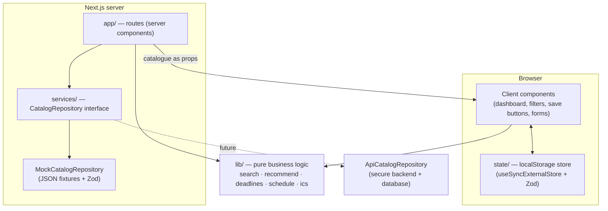

# CampusBridge

**Every campus opportunity, one bridge away.**

CampusBridge is a web application that brings scholarships, internships, campus events and student
organizations into one place. Students get **explainable recommendations**, **deadline tracking**
and a **calendar with clash detection**. Organization representatives and administrators get
role-specific workflows, which are currently **labelled demonstrations**.

> **Status: database-free prototype.** CampusBridge runs entirely on **fictional sample data**.
> There are no real accounts, no server-side storage and no secure roles yet. See
> [Known limitations](#19-known-limitations).
>
> **Independent project.** CampusBridge is a student project for CS341 Web Technologies. It is not
> affiliated with, endorsed by or operated by Ashesi University or any other institution.

---

## Contents

1. [Project introduction](#1-project-introduction)
2. [Academic context](#2-academic-context)
3. [Features and status](#3-features-and-status)
4. [Functional requirements](#4-functional-requirements)
5. [Non-functional requirements](#5-non-functional-requirements)
6. [Technology stack](#6-technology-stack)
7. [Architecture](#7-architecture)
8. [Repository structure](#8-repository-structure)
9. [Installation and commands](#9-installation-and-commands)
10. [Configuration](#10-configuration)
11. [Database-free development](#11-database-free-development)
12. [Team collaboration](#12-team-collaboration)
13. [Development roadmap](#13-development-roadmap)
14. [Testing](#14-testing)
15. [Viva quiz preparation](#15-viva-quiz-preparation)
16. [Presentation and demo plan](#16-presentation-and-demo-plan)
17. [Submission checklist](#17-submission-checklist)
18. [AI assistance and academic responsibility](#18-ai-assistance-and-academic-responsibility)
19. [Known limitations](#19-known-limitations)
20. [License](#20-license)

---

## 1. Project introduction

### Problem statement

University students hear about opportunities through many disconnected channels: email, group
chats, notice boards and social media. Our **working hypotheses** (not yet verified) are:

| #   | Hypothesis                                                                         |
| --- | ---------------------------------------------------------------------------------- |
| H1  | Opportunities are scattered across many channels, with no single place to look.    |
| H2  | Students miss scholarship and internship deadlines because they find out too late. |
| H3  | Club events are hard to discover outside a student's existing friend group.        |
| H4  | Students struggle to tell which opportunities fit their interests.                 |

### Proposed solution

One searchable platform that:

- unifies opportunities, events and organizations in a single search;
- ranks content for each student with a **transparent, rule-based score** that explains every recommendation;
- tracks saved deadlines by urgency, detects clashes between saved events and exports everything to the student's own calendar app (`.ics`);
- gives organization representatives and administrators their own workflows.

### Target users

| User                            | Needs                                                                      |
| ------------------------------- | -------------------------------------------------------------------------- |
| **Guest**                       | Browse and search public content.                                          |
| **Student**                     | Discover relevant items, save them, track deadlines, plan their week.      |
| **Organization representative** | Publish and update events for their organization.                          |
| **Administrator**               | Review new listings, catch scams or low-quality posts, understand content. |

### Objectives

1. Reduce the effort needed to find relevant opportunities.
2. Reduce missed deadlines through urgency grouping and calendar export.
3. Increase the visibility of student organizations and their events.
4. Demonstrate production-minded engineering: validation, accessibility, testing and CI.

### Validating the problem (to be done by the team)

We have **not** collected any user research yet, and no results are claimed. Suggested plan:

- **Survey** (Microsoft/Google Form, aim for 30+ students), for example:
  1. Where do you usually hear about scholarships, internships and events? (multi-select)
  2. In the last semester, did you miss an opportunity because you found out after the deadline? (yes / no / not sure)
  3. How many group chats do you rely on for campus information?
  4. How easy is it to find clubs that match your interests? (1–5)
  5. Would explained recommendations ("because you chose Research") make you trust suggestions more? (1–5)
  6. Which would you use most: search, recommendations, deadline tracker or calendar?
- **Interviews:** five 10-minute interviews, one per team member, using the same questions.
- Report the real numbers in the presentation, including any that do not support our hypotheses.
- Do **not** collect names or student IDs unless you have a consent process.

---

## 2. Academic context

- **Institution:** Ashesi University, Ghana
- **Course:** CS341 Web Technologies, final project
- **Team:** five Computer Science students

The weights below come from the team's summary of the course brief. **Team: check this section
against the official _CS341 Web Technologies — Final Project_ PDF before submission.**

| Criterion                         | Weight | How CampusBridge addresses it                                                                                                                                                 |
| --------------------------------- | ------ | ----------------------------------------------------------------------------------------------------------------------------------------------------------------------------- |
| Usefulness                        | 10%    | A real student problem (scattered opportunities, missed deadlines), a validation plan, and features students act on (save, track, export).                                    |
| Production-grade engineering      | 15%    | TypeScript throughout, Zod validation at every boundary, error and empty states, WCAG checks, responsive layouts, 75 unit/integration tests, 49 browser tests, CI.            |
| Ambition and technical complexity | 25%    | Field-weighted search engine with typo tolerance, explainable recommender, sweep-line clash detection, RFC 5545 calendar export, role workflows, moderation hints, analytics. |
| Individual viva quiz              | 50%    | A deliberately simple architecture (no microservices, no ORM yet), commented code, and a [viva guide](#15-viva-quiz-preparation).                                             |

---

## 3. Features and status

**Legend:** ✅ Implemented · 🟡 Partial or demo-only · 📋 Planned · ⏸ Deferred (needs a backend)

| Feature                                   | Status | Notes                                                                                                               |
| ----------------------------------------- | ------ | ------------------------------------------------------------------------------------------------------------------- |
| Home page                                 | ✅     | Search, closing-soon list, this week's events, disclaimer.                                                          |
| Unified search (`/explore`)               | ✅     | Opportunities, events and organizations; tabs with counts; filters in the URL; works without JavaScript (GET form). |
| Filters and sorting                       | ✅     | Interests, category, date window, location mode; sort by relevance, soonest or newest.                              |
| Opportunity, event and organization pages | ✅     | Source attribution, safe external links, related items, 404 for unknown IDs.                                        |
| Events directory                          | ✅     | Grouped by day, filter by category.                                                                                 |
| Organizations directory                   | ✅     | Filter by category; follow and unfollow.                                                                            |
| Interests and preferences                 | ✅     | Live preview of recommendations; reset all data.                                                                    |
| Explainable recommendations               | ✅     | Rule-based score with a points breakdown on every card.                                                             |
| Saved items and deadline tracker          | ✅     | Grouped by urgency (today, 7 days, 14 days, later, rolling, closed).                                                |
| Calendar and clash detection              | ✅     | Month grid plus accessible agenda; clashes highlighted.                                                             |
| Calendar export (`.ics`)                  | ✅     | Events plus all-day deadline entries; works in Outlook, Google and Apple Calendar.                                  |
| Organization rep workflow                 | 🟡     | **Demo only:** create, edit and delete events with full validation; stored in this browser only.                    |
| Admin review queue                        | 🟡     | **Demo only:** approve or reject (rejection needs a reason), undo, automated moderation hints.                      |
| Admin analytics                           | 🟡     | Charts computed from the **sample** catalogue, with table views. Not real usage data.                               |
| Event "interest" / RSVP                   | 🟡     | Adds the event to the student's calendar; **not** a reservation. Capacity is not enforced.                          |
| In-app deadline reminders                 | 📋     | Stretch goal (client-side).                                                                                         |
| Real accounts and authentication          | ⏸      | Needs a backend.                                                                                                    |
| Server-enforced roles and ownership       | ⏸      | Needs a backend.                                                                                                    |
| Multi-user persistence and sync           | ⏸      | Needs a backend.                                                                                                    |
| Email notifications                       | ⏸      | Needs a backend and an email provider.                                                                              |

---

## 4. Functional requirements

| ID    | Requirement                                                                                                         | Status |
| ----- | ------------------------------------------------------------------------------------------------------------------- | ------ |
| FR-1  | Users can search across opportunities, events and organizations with one query.                                     | ✅     |
| FR-2  | Users can filter by type, interest, category, date window and location mode, and sort results.                      | ✅     |
| FR-3  | Search state is stored in the URL and survives refresh, Back and sharing.                                           | ✅     |
| FR-4  | Closed opportunities and past events are excluded from search and recommendations.                                  | ✅     |
| FR-5  | Detail pages show structured attributes and attribute external sources.                                             | ✅     |
| FR-6  | Students can select interests and see recommendations update immediately.                                           | ✅     |
| FR-7  | Every recommendation lists the rules that produced its score.                                                       | ✅     |
| FR-8  | Students can save and unsave opportunities, mark interest in events, and follow organizations.                      | ✅     |
| FR-9  | Saved opportunities are grouped by deadline urgency.                                                                | ✅     |
| FR-10 | Overlapping saved events are detected and shown on the dashboard and calendar.                                      | ✅     |
| FR-11 | Saved events and deadlines can be exported as an `.ics` file.                                                       | ✅     |
| FR-12 | Organization reps (demo) can create, edit and delete events; the form validates every field and rejects past dates. | 🟡     |
| FR-13 | Admins (demo) can approve or reject pending items and see automated moderation hints.                               | 🟡     |
| FR-14 | Admins (demo) can view content analytics, each chart with a table alternative.                                      | 🟡     |
| FR-15 | Users can delete all their locally stored data.                                                                     | ✅     |

---

## 5. Non-functional requirements

| Quality         | Approach                                                                                                                                                                                                                                                                                                    |
| --------------- | ----------------------------------------------------------------------------------------------------------------------------------------------------------------------------------------------------------------------------------------------------------------------------------------------------------- |
| Responsiveness  | Mobile-first Tailwind layouts; slide-in menu below 1280px; automated "no horizontal scroll" test on a Pixel 7 viewport and a desktop viewport.                                                                                                                                                              |
| Accessibility   | Semantic HTML, skip link, visible focus rings, labelled controls, `aria-pressed` toggles, `aria-live` status messages, focus moved to the first form error, charts with table views. axe-core runs on 15 page states in CI.                                                                                 |
| Security        | No secrets; untrusted data validated with Zod (fixtures, URL parameters, localStorage, forms); React escapes all text (no `dangerouslySetInnerHTML`); https-only external links with `rel="noopener noreferrer"`; security headers (`X-Frame-Options`, `nosniff`, `Referrer-Policy`, `Permissions-Policy`). |
| Reliability     | Malformed records are skipped and logged; corrupt or tampered localStorage falls back to defaults; error boundaries (`error.tsx`, `global-error.tsx`); custom 404; empty and loading states everywhere.                                                                                                     |
| Performance     | Server components by default; JavaScript only for interactive "islands"; small dependency set; pages cached and revalidated hourly (ISR); charts only on the admin page.                                                                                                                                    |
| Maintainability | Business logic in pure functions under `src/lib` (no React), a single data-access interface, Zod schemas as the source of truth for types, ESLint, Prettier, a PR template and CI.                                                                                                                          |
| Time handling   | Dates stored as UTC ISO strings and compared by calendar day in `Africa/Accra`.                                                                                                                                                                                                                             |

---

## 6. Technology stack

| Technology                   | Why we chose it                                                                                                                   |
| ---------------------------- | --------------------------------------------------------------------------------------------------------------------------------- |
| **Next.js 16 (App Router)**  | Routing, server rendering and caching in one framework; a backend (route handlers) can be added later without a separate service. |
| **React 19**                 | Component model; `useSyncExternalStore` for the localStorage store.                                                               |
| **TypeScript**               | Catches mistakes at compile time and documents data shapes.                                                                       |
| **Tailwind CSS 4**           | Consistent design tokens (`globals.css`) without writing separate CSS files.                                                      |
| **Zod 4**                    | One schema both validates data at runtime and generates the TypeScript type.                                                      |
| **date-fns + @date-fns/tz**  | Small, explicit date maths in the campus time zone.                                                                               |
| **Radix Dialog**             | Accessible mobile menu (focus trap, Escape to close) without writing that logic ourselves.                                        |
| **lucide-react**             | Open-source icons.                                                                                                                |
| **Recharts**                 | Simple declarative bar charts for the admin analytics.                                                                            |
| **Vitest + Testing Library** | Fast unit and component tests.                                                                                                    |
| **Playwright + axe-core**    | Real-browser end-to-end and accessibility tests on desktop and mobile viewports.                                                  |
| **ESLint + Prettier**        | Consistent, reviewable code.                                                                                                      |
| **GitHub Actions**           | Runs every check on each pull request.                                                                                            |

**Deliberately not used yet:** a database, an ORM, an authentication library, global state
libraries (Redux and similar) and component libraries. Each would add concepts to learn without
helping the current prototype.

**A note on Next.js 16:** `cacheComponents` is switched **off** in `next.config.ts`. We use the
classic caching model (`export const revalidate = 3600`) because it is easier to explain.

---

## 7. Architecture

### Layers



### Data flow (example: the dashboard)

1. `app/dashboard/page.tsx` (a server component) asks `catalogRepository.getCatalog()` for content.
2. `MockCatalogRepository` reads the JSON fixtures, validates each record with Zod, turns the
   relative dates into real dates, and returns published items only.
3. The page passes the catalogue to `DashboardView` (a client component).
4. `DashboardView` reads the student's interests and saved items from the localStorage store,
   then calls the **pure** functions `recommend()`, `groupByDeadline()` and `conflictMap()`.
5. When the student changes an interest, the store updates, every subscribed component
   re-renders, and the recommendations change instantly.

### Key modules

| Module                 | Responsibility                                                                                 |
| ---------------------- | ---------------------------------------------------------------------------------------------- |
| `schemas/`             | Zod schemas: domain types, taxonomies, event-form validation.                                  |
| `services/`            | `CatalogRepository` interface plus the mock implementation. **The only place data is loaded.** |
| `lib/search/`          | Tokenising, field-weighted scoring, typo tolerance, filters, URL parameter parsing.            |
| `lib/recommend/`       | Scoring rules (`weights.ts`) and the ranking engine (`score.ts`).                              |
| `lib/deadlines.ts`     | Urgency buckets, labels and sorting.                                                           |
| `lib/schedule.ts`      | Overlap test and sweep-line clash detection.                                                   |
| `lib/ics.ts`           | RFC 5545 calendar export (escaping, line folding, all-day deadlines).                          |
| `lib/moderation.ts`    | Rule-based review hints (payment requests, unverifiable providers and so on).                  |
| `lib/analytics.ts`     | Aggregations for the admin charts.                                                             |
| `state/`               | Validated localStorage store, user data, demo data, React hooks.                               |
| `components/ui/`       | Design-system primitives (buttons, badges, form fields, empty states).                         |
| `components/features/` | Feature components (cards, dashboard, calendar, forms, admin).                                 |

### State management

- **URL**: search and filter state (`/explore?q=…&interest=…`), the source of truth for search.
- **localStorage** (`campusbridge:user:v1`): interests, saved IDs, follows and demo role.
- **localStorage** (`campusbridge:demo:v1`): demo event submissions and moderation decisions.
- **React state**: temporary UI state only (open menus, form drafts).

Both stores are versioned and validated, so tampered or outdated data resets safely.

### Routes

| Route                                                                         | Rendering                           |
| ----------------------------------------------------------------------------- | ----------------------------------- |
| `/`, `/dashboard`, `/saved`, `/calendar`, `/preferences`, `/manage`, `/admin` | Prerendered, revalidated hourly     |
| `/about`                                                                      | Static                              |
| `/explore`, `/events`, `/organizations`, detail pages                         | Rendered per request (read the URL) |

---

## 8. Repository structure

```
.
├── .github/
│   ├── workflows/ci.yml          # format, lint, typecheck, tests, build, e2e, audit
│   └── pull_request_template.md
├── e2e/                          # Playwright browser tests (journeys + accessibility)
├── scripts/vitest.mjs            # runs Vitest safely on Windows (see Testing)
├── src/
│   ├── app/                      # routes (one folder per URL), layout, error and 404 pages
│   ├── components/
│   │   ├── layout/               # header, footer, logo
│   │   ├── ui/                   # reusable primitives
│   │   └── features/             # feature components
│   ├── data/fixtures/            # FICTIONAL sample data (JSON)
│   ├── lib/                      # pure business logic (no React)
│   ├── schemas/                  # Zod schemas = source of truth for types
│   ├── services/                 # data-access interface + mock implementation
│   └── state/                    # localStorage stores and hooks
├── tests/
│   ├── unit/                     # business logic, validation, data, storage
│   └── integration/              # components + store + logic together
├── .env.example                  # documents that no variables are needed
├── AGENTS.md                     # generated by Next.js for AI coding tools (safe to ignore)
├── next.config.ts                # security headers, caching model
├── playwright.config.ts
└── vitest.config.mts
```

---

## 9. Installation and commands

**Requirements:** Node.js 20.9 or newer (tested with Node 24) and npm. Git for collaboration.

```bash
git clone <repository-url> campusbridge
cd campusbridge
npm ci                     # install exact versions from package-lock.json
npm run dev                # http://localhost:3000
```

| Command              | What it does                                                               |
| -------------------- | -------------------------------------------------------------------------- |
| `npm run dev`        | Development server with hot reload.                                        |
| `npm run build`      | Production build.                                                          |
| `npm run start`      | Serve the production build (run `build` first).                            |
| `npm run lint`       | ESLint.                                                                    |
| `npm run typecheck`  | Generates route types, then runs the TypeScript compiler.                  |
| `npm test`           | Unit and integration tests (Vitest).                                       |
| `npm run test:watch` | Vitest in watch mode while developing.                                     |
| `npm run test:e2e`   | Playwright tests (run `npm run build` first; it starts the server itself). |
| `npm run format`     | Format all files with Prettier.                                            |
| `npm run check`      | lint + typecheck + unit tests + build: **run this before every PR**.       |

First-time Playwright setup: `npx playwright install chromium`.

**Windows tip:** keep the project **outside OneDrive** (for example `C:\dev\campusbridge`).
OneDrive syncing thousands of files in `node_modules` slows installs and can lock files.

---

## 10. Configuration

No environment variables are needed. `.env.example` explains this. All `.env*` files except
the example are git-ignored. **Never commit real credentials.** When a backend is added, document
each new variable in `.env.example` with placeholder values only.

---

## 11. Database-free development

- **Sample data** lives in `src/data/fixtures/*.json`. Every organization, opportunity, event,
  provider, email address and member count is **fictional**. Links use the reserved
  `example.org` domain, and a unit test enforces this.
- **Relative dates.** Fixtures store `"deadlineInDays": 12` instead of a fixed date, so the demo
  never goes stale. `MockCatalogRepository` turns these into real dates relative to today
  (Accra time).
- **Validation.** Every record is checked with Zod when loaded. Invalid records are skipped and
  logged (try breaking one and run `npm test`).
- **Personal data** (interests, saved items, follows, demo role) is stored only in the browser's
  localStorage. It does not sync across devices and is lost if the browser data is cleared.
- **Demo roles** are a user-experience switch, **not security**. Anyone can choose any role.

**Adding a backend later:** create `ApiCatalogRepository implements CatalogRepository`, swap it
in `src/services/index.ts`, and move user data from localStorage to authenticated API calls.
Authorization (who may edit which organization, who is an admin) **must** be enforced on the
server. The current client-side role switch must then be removed. Use a brand-new, independent
database project and credentials.

**Recommendation for the final submission:** if the team wants to demonstrate genuine multi-user
features (real sign-in, shared reviews, organization ownership), add a small secure backend
(for example PostgreSQL with server-side authorization checks) before submitting. Otherwise,
present the role workflows clearly as demonstrations.

---

## 12. Team collaboration

### Proposed ownership

Each member owns one area, writes its tests, and **reviews another member's area**, so nobody
knows only their own code. Replace "Member N" with names.

| Member                               | Owns                                                                                     | Viva focus                                       | Reviews  |
| ------------------------------------ | ---------------------------------------------------------------------------------------- | ------------------------------------------------ | -------- |
| 1 — Coordinator & architecture       | `services/`, `state/`, routing in `app/`, CI, integration                                | Data flow, server vs client components, caching  | Member 5 |
| 2 — Design system & accessibility    | `components/ui/`, `components/layout/`, `globals.css`, responsive and a11y fixes         | Semantic HTML, focus, Tailwind tokens, WCAG      | Member 3 |
| 3 — Discovery & recommendations      | `lib/search/`, `lib/recommend/`, `/explore`, dashboard recommendations                   | Ranking formula, typo tolerance, URL state       | Member 4 |
| 4 — Events, organizations & calendar | `lib/schedule.ts`, `lib/ics.ts`, `lib/calendar-grid.ts`, events, organizations, calendar | Interval overlap, time zones, RFC 5545           | Member 1 |
| 5 — Data, testing & quality          | `schemas/`, fixtures, `tests/`, `e2e/`, manage/admin demo, security checklist            | Validation, testing pyramid, XSS, external links | Member 2 |

### Git workflow

1. `main` is always deployable. Ask the repository owner to enable **branch protection**: require
   a pull request, one approval and a passing CI run.
2. Create a branch per task: `feat/deadline-reminders`, `fix/calendar-overflow`, `docs/viva-notes`.
3. Make small commits with clear messages, for example `feat(search): add location filter`.
4. Before opening a PR, run `npm run check` and, for UI changes, `npm run test:e2e`.
5. Open a PR and fill in the template, including "What did you learn?" (useful viva preparation).
6. At least one teammate reviews it, ideally the assigned reviewer.
7. Squash-merge, then delete the branch.

```bash
git switch main && git pull
git switch -c feat/my-change
# …edit, test…
git add -A && git commit -m "feat(scope): describe the change"
git push -u origin feat/my-change    # then open a pull request on GitHub
```

---

## 13. Development roadmap

| Phase | Milestone                                                                 | Status                              |
| ----- | ------------------------------------------------------------------------- | ----------------------------------- |
| 1     | Requirements and proposal                                                 | ✅ Done                             |
| 2     | Foundation: tooling, design system, data model, CI                        | ✅ Done                             |
| 3     | Core: search, details, events, organizations, saved items, preferences    | ✅ Done                             |
| 4     | Advanced: recommendations, clash detection, `.ics`, role demos, analytics | ✅ Done                             |
| 5     | Quality: unit, integration, e2e and accessibility tests                   | ✅ Done (continue as features grow) |
| 6     | Documentation and team readiness                                          | ✅ This README                      |
| 7     | **Team**: run the survey and interviews, and report real findings         | 📋 Next                             |
| 8     | **Team**: each member extends their module (see ideas below)              | 📋 Next                             |
| 9     | Decide on a secure backend (accounts, roles, database)                    | 📋 Decision needed                  |
| 10    | Record the 15-minute video, then submit                                   | 📋                                  |

**Extension ideas, one per member:** in-app deadline reminders with configurable lead times (3);
a week view or "free time" finder in the calendar (4); a dark theme (2); a CSV import for
organization events with validation (5); a deployment pipeline (1).

---

## 14. Testing

### Strategy

| Level         | Tool                           | What it covers                                                                                                                                                                                                                                                | Count                  |
| ------------- | ------------------------------ | ------------------------------------------------------------------------------------------------------------------------------------------------------------------------------------------------------------------------------------------------------------- | ---------------------- |
| Unit          | Vitest                         | Recommendation scoring, search ranking and typo tolerance, URL parsing, deadlines, time zones, clash detection, month grid, `.ics`, form validation, fixture validity and colour contrast, repository reliability, localStorage safety, moderation, analytics | 69                     |
| Integration   | Vitest + Testing Library       | Interests change recommendations; saving updates the saved view; clashes shown; live preview; form errors and focus; valid form output                                                                                                                        | 6                      |
| End-to-end    | Playwright (desktop + Pixel 7) | Search to details; filters; save to saved/dashboard; recommendations persist; calendar clashes; follow; org rep submits and admin approves; 404; mobile menu; no horizontal scroll                                                                            | 10 tests × 2 viewports |
| Accessibility | Playwright + axe-core          | WCAG 2.2 A/AA rules on 14 pages plus the admin and manage demo states                                                                                                                                                                                         | 15 tests × 2 viewports |

### Results from the last run (18 November 2026, Windows 11, Node 24.18)

- `npm run lint`: passed, 0 problems
- `npm run typecheck`: passed
- `npm test`: **75 / 75 passed** (7 files)
- `npm run build`: passed
- `npm run test:e2e`: **49 passed, 1 skipped** (the mobile-menu test only runs on the mobile viewport)
- `npm audit --omit=dev`: **0 vulnerabilities** in production dependencies
- `npm audit` (including dev tools): 17 "high" findings, all from one transitive package
  (`picomatch` ReDoS, via ESLint, Vite and Vitest). No fixed version has been published yet. They
  affect only local tooling that processes our own trusted file patterns, not the deployed app.
  Re-check regularly.

### Known testing limitations

- Automated accessibility tools find only part of the issues. **Manual checks are still needed:**
  keyboard-only navigation through every page, a screen-reader pass (NVDA on Windows or VoiceOver
  on macOS/iOS) and 200% zoom.
- Only Chromium is tested automatically. Check Firefox and Safari manually before the demo.
- No performance budget is enforced yet. Run Lighthouse on the production build and record the
  real numbers rather than estimating them.
- **Windows:** `npm test` runs through `scripts/vitest.mjs`, which fixes a problem where terminals
  opened with a lower-case drive letter (`c:\…`) make Vitest fail with "failed to find the
  current suite".

---

## 15. Viva quiz preparation

Everyone should be able to explain the **whole** system, not just their own part. Study these in order:

1. **Request flow:** how `/explore?q=data` becomes HTML (server component, `searchParams`,
   repository, search engine, cards), and which parts become client JavaScript.
2. **Server vs client components:** why `DashboardView` needs `"use client"` and `cards.tsx` does not.
3. **State:** URL vs localStorage vs React state; why `useSyncExternalStore`; what
   `getServerSnapshot` prevents.
4. **Validation:** where Zod is used (fixtures, URL, storage, forms) and why client validation
   is not security.
5. **The recommender:** the rules in `weights.ts`, the relevance gate, deterministic tie-breaking,
   and why it is not machine learning.
6. **Search:** tokenising, stop words, field weights, prefix and one-edit typo matching, AND
   semantics, phrase bonus.
7. **Time:** UTC storage vs Accra display; calendar days vs 24-hour periods.
8. **Clash detection:** the overlap condition and the sweep-line algorithm (O(n log n + k)).
9. **Security:** XSS (React escaping), `noopener noreferrer`, https-only links, security headers,
   why demo roles are not authorization.
10. **Testing:** the testing pyramid here, and what each level catches.

### Practice questions

1. Walk through what happens, file by file, when a student ticks "Research" on the dashboard.
2. Two items have the same score. Which ranks first, and where is that decided?
3. Why are dates in the fixtures relative (`deadlineInDays`)? What would break with absolute dates?
4. A user edits localStorage and sets `"role": "superuser"`. What happens, and why?
5. Event A runs 17:00–18:00 and event B 18:00–19:00. Do they clash? Show the condition.
6. Why does `/explore` render on every request while `/dashboard` is prerendered?
7. How would you add a "salary" filter for internships? Which files change?
8. Someone stores `javascript:alert(1)` as an opportunity link. Which two layers stop it?
9. What would change in the architecture to support real accounts and organization ownership?
10. Why does the search filter form still work with JavaScript disabled?
11. What does `revalidate = 3600` mean, and why did we choose it?
12. How does the `.ics` export represent a deadline, and why is line folding needed?
13. Why is moving focus to the first invalid field important, and how is it implemented?
14. What does the integration test for saving prove that a unit test cannot?
15. Explain one bug found during development and how a test now prevents it. (Example: the
    contrast failures on organization colours, now enforced by a unit test.)

---

## 16. Presentation and demo plan

A suggested structure for the 15-minute video. Show only implemented features, and give each
member at least two minutes on their own area.

| Time  | Segment                                                                                                                                  | Presenter      |
| ----- | ---------------------------------------------------------------------------------------------------------------------------------------- | -------------- |
| 0–2   | The problem and **real** survey and interview findings                                                                                   | Member 1       |
| 2–4   | The solution, target users and a home page tour                                                                                          | Member 2       |
| 4–6   | Search: a typo ("scholarshp"), filters, the URL that preserves state, the empty state                                                    | Member 3       |
| 6–8   | Pick interests, show recommendations with point breakdowns, change an interest and show the re-ranking, open the About rules             | Member 3       |
| 8–10  | Save two clashing events, see the calendar warning, export `.ics` and open it in a calendar app; show deadline urgency groups            | Member 4       |
| 10–11 | Org rep demo: show validation errors, then submit; admin demo: moderation hints, approve, analytics (state clearly that these are demos) | Member 5       |
| 11–13 | Architecture diagram, code walkthrough of `score.ts` and `schedule.ts`, the test suite and CI                                            | Members 1 & 5  |
| 13–15 | Accessibility and security measures, honest limitations, and next steps (backend, reminders)                                             | Member 2 & all |

**Before recording:** run `npm run build && npm run start`, use a fresh browser profile, and
rehearse with a timer.

---

## 17. Submission checklist

- [ ] Video (≤ 15 minutes) uploaded to **OneDrive**, sharing set so the lecturer can open it
- [ ] The OneDrive video link submitted on **Canvas**
- [ ] Source code in a **public GitHub repository**
- [ ] The GitHub repository link submitted on **klenam.ai**
- [ ] `npm run check` and `npm run test:e2e` pass on `main`; CI is green
- [ ] README updated: real survey results, final feature status, team names
- [ ] Every member has reviewed the whole codebase and practised the viva questions
- [ ] Re-read the official brief for any requirement not covered here

---

## 18. AI assistance and academic responsibility

This codebase was **initially generated with AI assistance** (Anthropic's Claude, acting as a
coding agent). That included the proposal, scaffolding, implementation, tests and this README.
The lecturer's brief permits responsible AI-assisted development.

The team is responsible for everything submitted. Concretely, every member is expected to:

- read and understand the code in their area **and** the overall architecture;
- be able to modify, debug and extend it without AI help;
- check every claim in this README against the running application;
- record their own contributions in commits and pull requests.

If any part of the code cannot be explained by the team, it should be simplified or rewritten
before submission.

---

## 19. Known limitations

- **No backend.** All personal data stays in one browser. There is no cross-device sync and
  nothing is shared between users.
- **Demo roles are not secure.** Anyone can switch to "Administrator" or "Organization rep".
  Those areas change only the current browser's data and never the public catalogue.
- **Event interest is not registration.** Capacity is shown but not enforced.
- **Sample data only.** All content is fictional. Analytics describe the sample catalogue, not
  real usage.
- **Recommendations are rule-based**, with fixed weights chosen by the team, not learned from data.
- **Search is in-memory**, which is fine for hundreds of items. Thousands would need database
  full-text search.
- **Hypotheses are unvalidated** until the team completes the survey and interviews.
- **Time zone:** the app assumes Africa/Accra. Supporting other campuses means making the zone
  configurable.

---

## 20. License

No license has been chosen yet, so all rights are reserved by the authors by default. The five
team members should agree on a license (for example MIT) before adding a `LICENSE` file.
