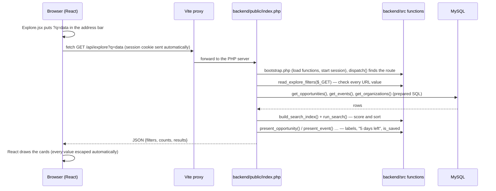
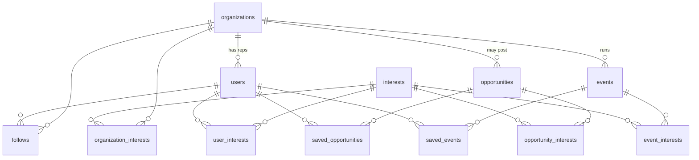

# CampusBridge

**Every campus opportunity, one bridge away.**

CampusBridge is a web application that brings **scholarships, internships, campus events and
student organizations** into one place. Students get **recommendations that explain themselves**,
**deadline tracking** and a **calendar that warns about clashing events**. Organization
representatives publish events, and administrators review new listings before they go public.

It is split into two parts: a **React** frontend (`frontend/`) and a **plain PHP 8 + MySQL 8** JSON API
with no framework (`backend/`). It runs on **AMPPS** (plus Node.js for the frontend) or **Docker**.

> **Independent student project.** CampusBridge is a CS341 Web Technologies project. It is not
> affiliated with, endorsed by or operated by Ashesi University or any other institution. All
> organizations, opportunities and events in the sample database are **fictional**.

---

## Contents

1. [What CampusBridge does](#1-what-campusbridge-does)
2. [Academic context](#2-academic-context)
3. [Features and status](#3-features-and-status)
4. [Run it with Docker](#4-run-it-with-docker)
5. [Run it with AMPPS](#5-run-it-with-ampps)
6. [Demo accounts](#6-demo-accounts)
7. [How the code is organized](#7-how-the-code-is-organized)
8. [The database](#8-the-database)
9. [Security](#9-security)
10. [Testing](#10-testing)
11. [Team collaboration](#11-team-collaboration)
12. [Viva quiz preparation: concepts and tech stack explained](#12-viva-quiz-preparation)
13. [Presentation and demo plan](#13-presentation-and-demo-plan)
14. [Submission checklist](#14-submission-checklist)
15. [AI assistance and academic responsibility](#15-ai-assistance-and-academic-responsibility)
16. [Known limitations](#16-known-limitations)
17. [License](#17-license)

---

## 1. What CampusBridge does

### The problem (our hypotheses, not yet verified)

| #   | Hypothesis                                                                         |
| --- | ---------------------------------------------------------------------------------- |
| H1  | Opportunities are scattered across email, group chats and posters.                 |
| H2  | Students miss scholarship and internship deadlines because they find out too late. |
| H3  | Club events are hard to discover outside a student's own friend group.             |
| H4  | Students struggle to tell which opportunities fit their interests.                 |

**How to check them:** run a short survey (30+ students) and five 10-minute interviews, one per
team member. Ask where students hear about opportunities, whether they missed a deadline last
semester, and whether explained recommendations would increase their trust. Report the real
numbers, including any that do not support the hypotheses. Do not collect names or student IDs
without consent.

### The solution

- **One search** across opportunities, events and organizations, with filters.
- **Explainable recommendations**: a points system that shows *why* each item is suggested.
- **Deadline tracking**: saved opportunities grouped by urgency (today, this week, …).
- **Calendar with clash detection**, plus export to Outlook, Google Calendar or Apple Calendar (`.ics`).
- **Roles**: students, organization representatives and administrators, each with their own pages.

### Users

| Role                            | Can do                                                                         |
| ------------------------------- | ------------------------------------------------------------------------------ |
| Guest                           | Browse and search everything that is published.                                |
| Student                         | Everything above, plus choose interests, save items, follow clubs, see the dashboard and calendar. |
| Organization representative     | Everything a student can do, plus create, edit and delete **their own organization's** events. |
| Administrator                   | Everything a student can do, plus approve or reject new listings and see analytics. |

---

## 2. Academic context

- **Course:** CS341 Web Technologies, Ashesi University. Five-member group project.
- **Deliverables:** a 15-minute video (OneDrive link on Canvas) and a public GitHub repository (link on klenam.ai).

These weights come from the team's summary of the brief. **Check them against the official PDF.**

| Criterion                         | Weight | How CampusBridge addresses it                                                                                                 |
| --------------------------------- | ------ | ----------------------------------------------------------------------------------------------------------------------------- |
| Usefulness                        | 10%    | A real student problem, a plan to validate it, and features students act on (save, track, export).                             |
| Production-grade engineering      | 15%    | Real accounts with hashed passwords, server-side role checks, prepared statements, CSRF protection, validation, clear error answers, responsive design, 97 automated tests, CI. |
| Ambition and technical complexity | 25%    | Search engine with typo tolerance, explainable recommender, clash detection algorithm, `.ics` export, review workflow, analytics. |
| Individual viva quiz              | 50%    | Plain PHP with no framework "magic", heavily commented code, and the [viva guide](#12-viva-quiz-preparation).                  |

---

## 3. Features and status

✅ = implemented and tested · 📋 = planned

Paths starting with `pages/` are React pages in `frontend/src/`; `routes/` and the other `.php`
files are the PHP API in `backend/src/`.

| Feature                                   | Status | Where                                         |
| ----------------------------------------- | ------ | --------------------------------------------- |
| Home page with search and highlights      | ✅     | `pages/Home.jsx`, `routes/catalogue.php`      |
| Unified search, filters and sorting       | ✅     | `pages/Explore.jsx`, `search.php`             |
| Opportunity, event and organization pages | ✅     | `pages/Details.jsx`, `routes/catalogue.php`   |
| Events by day, organizations by category  | ✅     | `pages/Lists.jsx`, `routes/catalogue.php`     |
| Accounts: sign up, sign in, sign out      | ✅     | `pages/Account.jsx`, `routes/account.php`, `auth.php` |
| Interests and recommendations             | ✅     | `pages/Student.jsx`, `recommend.php`          |
| Save, "I'm interested" and follow         | ✅     | `ToggleButton` in `components/cards.jsx`, `POST /api/toggle` |
| Deadline tracker                          | ✅     | `pages/Student.jsx` (Saved), `deadlines.php`  |
| Calendar with clash detection             | ✅     | `pages/Student.jsx` (Calendar), `schedule.php` |
| Calendar export (`.ics`)                  | ✅     | `GET /api/calendar.ics`, `ics.php`            |
| Org rep: create, edit, delete own events  | ✅     | `pages/Manage.jsx`, `routes/manage.php`       |
| Admin: review queue with automated hints  | ✅     | `pages/Admin.jsx`, `routes/admin.php`, `moderation.php` |
| Admin: analytics charts                   | ✅     | `components/BarChart.jsx`, `analytics.php`    |
| Cross-campus: events for everyone or one campus only | ✅ | `data/campuses.php`, `data/events.php` |
| Student resources with IP declaration     | ✅     | `pages/Resources.jsx`, `routes/resources.php`, `data/resources.php` |
| Org rep: publish, reject, take down resources | ✅ | `pages/Manage.jsx`, `routes/manage.php`       |
| Background privacy & copyright scanner    | ✅     | `backend/bin/scan-worker.php`, `resource_scan.php` |
| Study focus rooms: shared Pomodoro timer, who's studying, break-only chat | ✅ | `frontend/src/study-rooms/`, `backend/src/study-rooms/` |
| Deadline reminder emails                  | 📋     | Needs an email service                        |
| Password reset by email                   | 📋     | Needs an email service                        |
| Event registration with capacity limits   | 📋     | "I'm interested" is a bookmark, not a reservation |

---

## 4. Run it with Docker

The easiest option: one command starts the React website, the PHP API, MySQL, phpMyAdmin and the
resource scan worker.

**Requirements:** [Docker Desktop](https://www.docker.com/products/docker-desktop/).

```bash
git clone https://github.com/Tanseychuong/campus_bridge.git
cd campus_bridge
docker compose up --build
```

| Open                                | What                                                    |
| ----------------------------------- | ------------------------------------------------------- |
| http://localhost:8080               | CampusBridge (the React app)                            |
| http://localhost:8000/api/session   | The PHP API directly (JSON)                              |
| http://localhost:8081               | phpMyAdmin (user `root`, password `campusbridge-dev`)  |

- **Port 8000 already in use?** Create a `.env` file next to `docker-compose.yml` containing `API_PORT=8010`
  (or any free port), then `docker compose up -d --force-recreate api`. If the API's port is taken, Docker
  starts the `api` container without a network, and the website shows "cannot reach its server".
- The first start imports `backend/database/schema.sql` and `backend/database/seed.sql` automatically.
- The first start also runs `npm install` inside the `web` container, so it takes a minute or two.
- Your code is shared with the containers: React changes appear instantly (Vite "hot reload"),
  PHP changes apply on the next request.
- The `worker` service scans uploaded resources in the background. See what it is doing with
  `docker compose logs -f worker`. After changing scanner code, restart it: `docker compose restart worker`.
- **Reset the database** (for example to refresh the sample dates): `docker compose down -v`, then `docker compose up`.
- Stop everything: `docker compose down`.

---

## 5. Run it with AMPPS

**Requirements:** [AMPPS](https://ampps.com/) with PHP 8.2 and MySQL 8, plus
[Node.js 20 or newer](https://nodejs.org/) for the React frontend.

AMPPS runs the **backend** (Apache + PHP + MySQL). Node.js runs the **frontend** next to it.

1. **Copy the project** into the AMPPS web folder, for example `C:\Program Files\Ampps\www\campus_bridge`
   (or clone it there with Git).
2. **Start Apache and MySQL** in the AMPPS control panel. Apache's `mod_rewrite` must be on (it is by default).
3. **Create the database:** open http://localhost/phpmyadmin, click **New**, name it `campus_bridge`,
   and choose collation `utf8mb4_unicode_ci`.
4. **Import the tables, then the data:** select the `campus_bridge` database, open **Import**, and import
   `backend/database/schema.sql` first, then `backend/database/seed.sql`.
5. **Set your MySQL password** if it is not the AMPPS default (`mysql`): copy
   `backend/src/config.local.example.php` to `backend/src/config.local.php` and enter your password. This
   file is git-ignored, so your password is never pushed.
6. **Check the API:** http://localhost/campus_bridge/backend/public/api/session should show some JSON
   like `{"user":null,"csrf_token":"…"}`.
7. **Start the React app** in a terminal:
   ```bash
   cd frontend
   npm install                     # once
   # Windows PowerShell:  $env:API_PROXY_TARGET="http://localhost/campus_bridge/backend/public"; npm run dev
   API_PROXY_TARGET=http://localhost/campus_bridge/backend/public npm run dev
   ```
   Open **http://localhost:5173**. Vite forwards every `/api/...` request to AMPPS.
8. **Start the scan worker** in another terminal: `php backend/bin/scan-worker.php` (leave it
   running). Without it, uploaded resources stay at "check in progress". For a one-off run use
   `php backend/bin/scan-worker.php --once`. Reading Office files needs PHP's `zip` extension (enable it in
   AMPPS's PHP settings); without it the scanner asks the rep to check those files by eye. For uploads up to
   10 MB, set `upload_max_filesize = 10M` and `post_max_size = 12M` in AMPPS's PHP settings.

**No AMPPS?** Any PHP 8.2 can serve the API: `php -S localhost:8000 -t backend/public backend/public/index.php`,
then `npm run dev` in `frontend/` (it proxies to `http://localhost:8000` by default). If Windows says port
8000 is not allowed, pick another port and set `API_PROXY_TARGET` to match.

**Troubleshooting**

- *"CampusBridge cannot reach its database"*: MySQL is not running, the database is not imported, or
  the password in `config.local.php` is wrong.
- *"CampusBridge is not available"* in the React app: the API is not running, or `API_PROXY_TARGET`
  points to the wrong address. Open the address from step 6 to check.
- *Sample dates look old*: the sample dates are relative to the day you imported `seed.sql`.
  Re-import both files to refresh them.
- To see detailed errors while developing, set `'debug' => true` in `backend/src/config.local.php`;
  error answers from the API then include a `debug` message.

---

## 6. Demo accounts

These exist only in the sample data. The password for all of them is **`CampusBridge2026!`**.

| Email                   | Role                                            |
| ----------------------- | ----------------------------------------------- |
| `student@example.org`   | Student, Hillside Campus                        |
| `riverside@example.org` | Student, Riverside Campus                       |
| `rep@example.org`       | Organization rep for *Code & Circuits Society* (organization 1, Hillside) |
| `rep2@example.org` … `rep16@example.org` | Rep for organization 2 … 16 (e.g. `rep9@example.org` = *Open Design Studio*, Riverside) |
| `admin@example.org`     | Administrator (sees every campus)               |

**Campuses.** Every organization and student belongs to a campus. When an organizer creates an event
they choose **Everyone (all campuses)** or **Only students on our campus**. Campus-only events are
filtered out in SQL (`event_visibility_condition()`), so they never reach guests or other campuses —
try *Inter-Year Football Tournament* as the Hillside vs the Riverside student.

**Resources.** Students share files on **Resources → Share a resource** and sign an intellectual-property
declaration (who created it, credits, licence, three confirmations and a typed signature). The file is
stored outside the web root (`backend/storage/uploads/`) under a random name and stays private until the rep of the
chosen organization publishes it on their **Manage** page. Reps can take a public resource down, and
publish it again, at any time. Uploads are limited to 10 MB and the file type is checked from its content.

**Automatic privacy & copyright check.** A background worker (`backend/bin/scan-worker.php`) picks up every new
upload, reads its text (TXT/MD, PDF, Word, PowerPoint, Excel and text files inside ZIPs) and shows the rep
what to look at before publishing. Like the admin review hints, it never decides by itself.

| Looks for | Examples |
| --------- | -------- |
| **Privacy** | Ghana Card / passport numbers, bank card numbers (Luhn check), lists of emails or phone numbers, student IDs, dates of birth, passwords, health, bank and grade details |
| **Copyright** | Publisher notices and ISBNs (pages copied from a textbook), someone else's © notice when the student declared sole ownership, answer keys / solutions manuals / exam papers, "do not distribute" notices, a different author in the file's properties, the identical file already uploaded by another student |
| **Check by eye** | Images and scanned PDFs, which cannot be read as text |

Findings never repeat the personal data (emails are shown as `e***@example.org`), and **Publish** asks for
confirmation when a serious issue was found.

Anyone can also create a new student account on the **Create account** page. Organization reps
and admins are assigned in the database (`users.role` and `users.organization_id`).
**Delete or change these demo accounts before any real use.**

---

## 7. How the code is organized

The project is split in two:

- **`frontend/`** — a **React** app. It draws every page in the browser and never touches the database.
- **`backend/`** — a **plain PHP** JSON API (no framework). It owns all the rules: accounts, roles,
  search, recommendations, deadlines, clash detection, validation and every SQL query.

They talk over HTTP: React calls addresses like `GET /api/events/5` and gets JSON back.

```
campus_bridge/
├── frontend/                    THE REACT APP (what users see)
│   ├── index.html               the one HTML page; React fills <div id="root">
│   ├── vite.config.js           dev server + proxy that forwards /api/... to the PHP backend
│   ├── package.json             React, React Router, Vite (exact versions)
│   ├── public/icon.svg
│   └── src/
│       ├── main.jsx             starts React
│       ├── App.jsx              which page for which address (React Router)
│       ├── api.js               fetch() wrapper: JSON, CSRF header, errors, safeReturnPath()
│       ├── session.jsx          signed-in user, fixed lists ("meta") and flash messages, shared by all pages
│       ├── hooks.js             useApi() loads data, useTitle(), useFocusFirstError()
│       ├── components/          Layout (header/footer), cards, ToggleButton, BarChart, small UI pieces
│       ├── pages/               Home, Explore, Details, Lists, Account, Student, Manage, Admin, Resources, About
│       └── styles/app.css       the stylesheet (unchanged class names from the PHP version)
├── backend/                     THE PHP API
│   ├── public/                  ← the ONLY folder the web server shows
│   │   ├── index.php            front controller: every /api/... request starts here
│   │   └── .htaccess            sends every address to index.php
│   ├── src/
│   │   ├── bootstrap.php        loaded first: functions, time zone, JSON errors, session
│   │   ├── http/router.php      a 50-line router: route('GET', '/api/events/{id}', fn…)
│   │   ├── http/responses.php   send_json(), abort(404, '…'), form-error answers
│   │   ├── http/present.php     turns database rows into the JSON the pages show
│   │   ├── routes/              one file per area: account, catalogue, student, resources, manage, admin
│   │   ├── config.php           settings (database, time zone)
│   │   ├── database.php         PDO connection + fetch_all / fetch_one / execute
│   │   ├── helpers.php          reading JSON / form input, lines(), plural()
│   │   ├── security.php         sessions, CSRF tokens, security headers
│   │   ├── auth.php             sign in/out, current_user(), require_role()
│   │   ├── taxonomy.php         category and interest labels
│   │   ├── dates.php            time-zone-aware date helpers
│   │   ├── deadlines.php        urgency buckets for deadlines
│   │   ├── schedule.php         clash detection
│   │   ├── recommend.php        the recommendation rules
│   │   ├── search.php           the search engine and filters
│   │   ├── ics.php              calendar export
│   │   ├── moderation.php       review hints for admins
│   │   ├── analytics.php        numbers for the charts
│   │   ├── validation.php       form checking
│   │   ├── resource_scan.php    the privacy & copyright scanner
│   │   └── data/                ALL SQL lives here: organizations, opportunities, events, users, resources…
│   ├── bin/scan-worker.php      background worker that runs the scanner
│   ├── database/
│   │   ├── schema.sql           creates the tables
│   │   └── seed.sql             fictional sample data + demo accounts
│   ├── storage/uploads/         uploaded files (outside public/, git-ignored)
│   ├── tests/
│   │   ├── Unit/                tests for the logic (no database needed)
│   │   ├── Feature/             tests that call the real API against a test database
│   │   └── Support/             test helpers (a tiny API client)
│   ├── docker/Dockerfile        the Apache + PHP image
│   └── composer.json            only needed for running the tests (PHPUnit)
├── docker-compose.yml           React (web) + API + worker + MySQL + phpMyAdmin
└── .github/workflows/ci.yml     automatic checks on GitHub (backend tests, frontend build)
```

### The API

Every answer is JSON. Errors look like `{"error": "…"}`, and form errors add one message per field:
`{"error": "Please fix 2 fields below.", "errors": {"title": "Title must be at least 5 characters."}}`.

| Method & address                         | Who            | What                                             |
| ---------------------------------------- | -------------- | ------------------------------------------------ |
| `GET /api/session`                       | anyone         | Signed-in user (or `null`) and the CSRF token    |
| `GET /api/meta`                          | anyone         | Fixed lists: interests, categories, campuses, licences… |
| `POST /api/login` · `/api/logout` · `/api/register` | anyone | Accounts                                   |
| `GET /api/home` · `/api/explore?q=…`     | anyone         | Home highlights, search with filters             |
| `GET /api/opportunities/{id}` · `/api/events/{id}` · `/api/organizations/{id}` | anyone | Detail pages |
| `GET /api/events?category=…` · `/api/organizations?category=…` | anyone | Lists                          |
| `POST /api/toggle`                       | signed in      | Save / I'm interested / Follow (press again to undo) |
| `GET /api/dashboard` · `/api/saved` · `/api/calendar?month=…` · `/api/calendar.ics` | signed in | Personal pages |
| `GET /api/preferences` · `PUT /api/preferences/interests` · `POST /api/preferences/reset` | signed in | Preferences |
| `GET /api/resources` · `GET /api/resources/{id}/download` | anyone (rules apply) | Shared resources       |
| `GET /api/resources/options` · `POST /api/resources` | students | Upload a resource with the IP declaration       |
| `GET /api/manage` · `GET/POST/PUT/DELETE /api/manage/events…` · `POST /api/manage/resources/{id}` | org reps | Own events and resource reviews |
| `GET /api/admin` · `POST /api/admin/review` | admins      | Review queue and analytics                       |

### The life of one request

What happens when someone types "data" into the Explore search:



Every API route follows the same simple pattern (`backend/src/routes/`):

```php
route('GET', '/api/saved', function (): array {
    $user = require_login();                              // 1. check who is allowed (401/403 otherwise)
    $profile = get_student_profile((int) $user['id']);    // 2. get data (prepared SQL in src/data/)
    $events = get_events();
    return ['events' => array_map(...present_event...)];  // 3. return an array: it is sent as JSON
});
```

And every React page follows this one (`frontend/src/pages/`):

```jsx
export function Saved() {
    const result = useApi('/api/saved');                  // 1. ask the API
    return (
        <ApiView result={result}>                         {/* 2. loading / 401 → sign in / 404 / error */}
            {(data) => <ul>{data.events.map(...)}</ul>}   {/* 3. draw the data */}
        </ApiView>
    );
}
```

Requests that **change** data (`POST`, `PUT`, `DELETE`) carry the CSRF token in an `X-CSRF-Token`
header. The API checks it, checks permissions, updates the database and answers with a `message`
that React shows at the top of the page.

**Why keep all the logic in PHP?** React only displays what the API sends: dates are already in campus
time, labels such as "5 days left" are already worked out, and `is_saved` is already set. The rules live
in one place, the PHP tests cover them, and the viva story for the algorithms is unchanged.

---

## 8. The database



- **Main tables:** `organizations`, `opportunities`, `events`, `users`, `interests`.
- **Join tables** (many-to-many): `*_interests`, `saved_opportunities`, `saved_events`, `follows`.
  Their primary key is the pair of ids, so the same item cannot be saved twice.
- **Status column:** `published`, `pending` or `rejected`. Only published items are shown to the public.
- **Dates** are stored in UTC (`DATETIME`). Ghana uses UTC+0, so stored times equal campus times.
- **Foreign keys with `ON DELETE CASCADE`**: deleting an event also deletes its saved-event and interest rows.
- **Indexes** on `(status, deadline)` and `(status, starts_at)` speed up the most common queries.

---

## 9. Security

| Threat                        | What could go wrong                                      | How CampusBridge prevents it                                   | Where |
| ----------------------------- | -------------------------------------------------------- | -------------------------------------------------------------- | ----- |
Paths are inside `backend/src/` unless they start with `frontend/`.

| Threat                        | What could go wrong                                      | How CampusBridge prevents it                                   | Where |
| ----------------------------- | -------------------------------------------------------- | -------------------------------------------------------------- | ----- |
| SQL injection                 | Typed text changes an SQL query                          | Every query uses PDO **prepared statements** with `?` placeholders | `database.php`, `data/` |
| Cross-site scripting (XSS)    | Someone stores `<script>` in a title                     | React escapes every `{value}` it draws, and we never use `dangerouslySetInnerHTML`; the API sends JSON with `nosniff` and encodes `<` `>` as `<` `>` | `frontend/src/components/ui.jsx`, `http/responses.php` |
| Cross-site request forgery (CSRF) | Another site sends a request while you are signed in | A secret token from `GET /api/session`, sent back in an `X-CSRF-Token` header and checked with `hash_equals` on every POST/PUT/DELETE | `security.php`, `http/router.php`, `frontend/src/api.js` |
| Stolen passwords              | Database leak reveals passwords                          | `password_hash()` (bcrypt with a random salt) and `password_verify()`; the hash never leaves the server (`present_user()`) | `data/users.php`, `auth.php` |
| Password guessing             | Unlimited sign-in attempts                               | A 30-second pause after 5 failures; the same message for a wrong email or password | `routes/account.php` |
| Session hijacking or fixation | Someone steals or plants a session ID                    | HttpOnly + SameSite cookies (React cannot read them either); a new session ID after sign-in | `security.php`, `auth.php` |
| Broken access control         | A student calls the admin API, or a rep edits another club's event | `require_role()` in every protected route (401/403); ownership checked in SQL (`WHERE id = ? AND organization_id = ?`). Hiding a link in React is never the protection | `auth.php`, `routes/manage.php` |
| Open redirect                 | A link sends people to a fake site after sign-in         | `safeReturnPath()` only allows local paths                     | `frontend/src/api.js` |
| Clickjacking                  | Our pages are shown inside another site's frame          | `X-Frame-Options: DENY` and `frame-ancestors 'none'`           | `security.php` |
| Exposed source code           | Browsers download `src/` or `database/`                  | Only `backend/public/` (just `index.php`) is the web root; other folders have `Require all denied` | `.htaccess` files, `docker/Dockerfile` |
| Leaked secrets                | Passwords pushed to GitHub                               | `config.local.php` and `.env` are git-ignored                  | `.gitignore` |
| Unsafe external links         | A `javascript:` link, or a new tab that controls ours    | The API only sends `https://` links (`source.url` is `null` otherwise); `rel="noopener noreferrer"` | `http/present.php`, `frontend/src/pages/Details.jsx` |
| Unsafe uploads                | An uploaded HTML/SVG file runs as part of our site       | File type checked from its content; files stored outside the web root and always sent as a download | `data/resources.php`, `routes/resources.php` |

---

## 10. Testing

All tests live in `backend/tests/` and run with PHPUnit.

| Suite             | What it checks                                                                                           |
| ----------------- | -------------------------------------------------------------------------------------------------------- |
| `tests/Unit`      | Recommendation rules, search scoring and typos, filters from the URL, dates, deadlines, clash detection, `.ics`, moderation, analytics, validation, the resource scanner, the router's `{id}` matching, the presenters (unsafe links and colours removed) |
| `tests/Feature`   | The real API against a separate test database, called the way React calls it: every public endpoint, 404/401/403/405 answers, JSON encoding of `<script>`, security headers, sign-up, sign-in, CSRF rejection, saving, recommendations, calendar clashes, `.ics` download, follows, campus-only events, role restrictions, the submit → review → publish workflow, ownership checks, resource uploads, the IP declaration and the scan worker |

The React app is checked by `npm run build` in CI. It has no automated UI tests yet (see "Not yet tested").

### Run the tests

The tests need **Composer** (for PHPUnit) and, for feature tests, a **MySQL server**. Feature
tests create and delete their own database called `campus_bridge_test`; your real data is never touched.
Run these commands inside `backend/`:

```bash
cd backend
composer install            # once; or: docker run --rm -v "$PWD":/app -w /app composer:2 install

# With Docker's MySQL (docker compose up must be running):
TEST_DB_PORT=3307 TEST_DB_PASSWORD=campusbridge-dev vendor/bin/phpunit

# With AMPPS MySQL (default port 3306; use your own password):
TEST_DB_PASSWORD=your-password vendor/bin/phpunit

vendor/bin/phpunit --testsuite unit     # logic only, no database needed
```

On Windows PowerShell, set the variables first: `$env:TEST_DB_PASSWORD="…"; vendor/bin/phpunit`.

### Last results (18 November 2026, Windows 11, PHP 8.2.33, MySQL 8.0)

After the split into `frontend/` and `backend/`:

- `php -l` on every PHP file: no syntax errors
- `vendor/bin/phpunit`: **97 tests, 312 assertions, all passing** (1 skipped locally: reading Word
  files needs PHP's `zip` extension, which CI installs)
- `npm run build`: the React app builds without errors
- Checked through the Vite proxy with `curl`: session cookie and CSRF token, sign-in, dashboard JSON,
  `.ics` download and React Router addresses all answer correctly
- `npm audit`: one remaining advisory, in `picomatch` (a build-time dependency of Vite, no fixed version
  yet); it is never sent to the browser

### Not yet tested

- **Clicking through the React pages in a browser.** The API is covered by tests and the app builds, but
  nobody has yet opened every page, filled every form and compared it with the PHP version. Do this
  before the demo, on desktop and phone widths.
- The Docker setup and an AMPPS install after the split (`docker compose up --build`; AMPPS steps above).
- Automated accessibility scanning (axe), React UI tests and cross-browser tests. Check by hand:
  keyboard-only navigation, a screen reader (NVDA or VoiceOver), 200% zoom, Firefox and Safari.

---

## 11. Team collaboration

### Suggested ownership

Each member owns an area, writes its tests, and **reviews someone else's area**.

| Member                          | Owns                                                            | Reviews  |
| ------------------------------- | --------------------------------------------------------------- | -------- |
| 1 — Coordinator & architecture  | `backend/public/index.php`, `src/http/`, `bootstrap.php`, `config.php`, `database.php`, Docker, CI | Member 5 |
| 2 — Design & accessibility (React) | `frontend/src/components/`, `Layout.jsx`, `styles/app.css`, responsive layout | Member 3 |
| 3 — Discovery & recommendations | `search.php`, `recommend.php`, `routes/catalogue.php`, `pages/Explore.jsx`, `pages/Home.jsx` | Member 4 |
| 4 — Events, calendar & clubs    | `schedule.php`, `ics.php`, `deadlines.php`, `routes/student.php`, `pages/Student.jsx`, `pages/Lists.jsx` | Member 1 |
| 5 — Accounts, roles & data      | `auth.php`, `security.php`, `validation.php`, `src/data/`, `database/`, `routes/manage.php`, `routes/admin.php`, `pages/Account.jsx`, tests | Member 2 |

### Git workflow

1. Never work directly on `main`. Make a branch: `git switch -c feature/reminder-emails`.
2. Commit small steps with clear messages: `git commit -m "Add deadline filter to saved page"`.
3. Push and open a **pull request**. Fill in the template, including "What did you learn?".
4. A teammate reviews it, and the CI checks must pass before merging.
5. Ask the repository owner to turn on **branch protection** for `main` (Settings → Branches).

---

## 12. Viva quiz preparation

Everyone should be able to explain **the whole system**, not only their own part. Each topic below
says **what it is**, **why we use it** and **where to find it in the code**.

### 12.1 The tech stack

| Technology      | What it is, in one sentence                                                             | Why we chose it                                                                    |
| --------------- | --------------------------------------------------------------------------------------- | ---------------------------------------------------------------------------------- |
| **HTML**        | The structure of a page (headings, lists, forms).                                        | React produces semantic HTML (headings, lists, `<nav>`, `<label>`) for screen readers. |
| **CSS**         | Rules for how the HTML looks (colours, spacing, layout).                                 | One file, `frontend/src/styles/app.css`, using CSS variables, Flexbox, Grid and media queries. |
| **JavaScript**  | Code that runs in the browser.                                                           | The whole frontend is JavaScript (React).                                          |
| **React 18**    | A JavaScript library for building pages out of **components** that redraw when their data changes. | Pages update instantly (filters, Save buttons) without reloading, and each piece of UI is one reusable function. |
| **JSX**         | HTML-like syntax inside JavaScript: `<h1>{event.title}</h1>`.                           | Easy to read; every `{value}` is escaped automatically, which prevents XSS.        |
| **React Router**| Maps addresses such as `/events/5` to React pages, without reloading the page.          | Links can still be bookmarked and shared; Back and Refresh work.                    |
| **Vite**        | The development server and build tool for the React app.                                 | Starts in a second, reloads on save, and its proxy sends `/api/...` to PHP.        |
| **npm / Node.js** | JavaScript's package manager and runtime (only needed on the developer's computer).  | Installs React and Vite with exact, locked versions (`package-lock.json`).         |
| **PHP 8.2**     | A language that runs **on the server**.                                                  | Our backend: it checks every request, runs the rules and the SQL, and answers with JSON. Taught in the course, no framework needed. |
| **JSON**        | A text format for data: `{"title": "Hackathon", "id": 5}`.                               | The language React and PHP use to talk to each other (`json_encode` / `fetch`).    |
| **REST-style API** | Addresses + HTTP methods that read (`GET`) or change (`POST`, `PUT`, `DELETE`) data.  | A clear contract between the two halves (see [The API](#the-api)).                 |
| **MySQL 8**     | A relational database: data in tables linked by keys, queried with SQL.                 | Reliable, free, included in AMPPS, and the standard partner of PHP.                |
| **PDO**         | PHP's built-in library for talking to databases.                                         | Supports prepared statements, which protect against SQL injection.                 |
| **Apache**      | The web server that receives requests and runs our PHP files.                            | Included in AMPPS and in the Docker image; `.htaccess` lets us protect folders.    |
| **AMPPS**       | A Windows/Mac package that installs Apache, MySQL, PHP and phpMyAdmin together.         | Easy local setup, already familiar from class.                                     |
| **Docker**      | Runs software in "containers" with the exact same setup on every computer.               | One command gives every teammate the same PHP, Apache and MySQL versions.          |
| **phpMyAdmin**  | A web page for looking at and editing a MySQL database.                                 | Handy for importing the SQL files and checking data during development.            |
| **Composer**    | PHP's package manager.                                                                   | Only used to install PHPUnit for testing; the app itself has no dependencies.      |
| **PHPUnit**     | PHP's standard testing tool.                                                             | Runs our 97 automated tests.                                                       |
| **Git & GitHub**| Version control and online hosting for the code.                                          | Branches, pull requests, code review and history.                                  |
| **GitHub Actions** | Runs our tests automatically on GitHub's computers.                                   | Every pull request is checked before it is merged (`.github/workflows/ci.yml`).    |

**Why React for the frontend?** The pages are interactive: filters apply as you click, Save buttons
change without a reload, forms show errors next to each field. React keeps that logic in small
components, and the server stays responsible for every rule.

**Why plain PHP (no Laravel) for the backend?** Frameworks save time, but they hide a lot of behaviour
behind conventions ("magic"). Plain PHP shows every step: the router (`src/http/router.php`, about
50 lines), the SQL and the JSON. That is easier to explain in the viva and easier for beginners to
follow. Laravel would give us a router, an ORM and validation out of the box; we wrote small versions
of each ourselves instead.

### 12.2 How the web works

- **Client and server.** The browser (client) downloads the React app once. After that, React asks the
  server (Apache + PHP) for **data** with `fetch()`, and draws the page itself. PHP code never reaches the
  browser, only its JSON output.
- **Single-page application (SPA).** There is one HTML page (`frontend/index.html`). Clicking a link
  changes the address and swaps the React page without a full reload.
- **HTTP request and response.** A request has a method (`GET`/`POST`/`PUT`/`DELETE`), a URL and headers. A
  response has a status code, headers and a body (here: JSON).
- **GET vs POST/PUT/DELETE.** `GET` *reads* (search, open a page); its values are in the URL, so they can be
  bookmarked. The others *change* data; their values are in the request body. We never change data with GET.
- **Query string.** In `/api/explore?q=data`, the part after `?` holds values that PHP reads from `$_GET`.
- **Status codes in our API:** `200 OK`, `201 Created` (new account, event or upload), `400` bad request or
  CSRF, `401` not signed in (React shows the sign-in page), `403` wrong role, `404` not found, `405` wrong
  method, `413` file too large, `422` form errors, `429` too many sign-in attempts, `500` server error.
- **Proxy.** In development, Vite (port 5173) forwards `/api/...` to PHP, so the browser sees one website
  and sends the session cookie with every request.

### 12.3 PHP concepts used

- **`require`** loads another PHP file. `backend/public/index.php` requires `bootstrap.php` and the route files.
- **Front controller.** One file (`index.php`) receives every request; `.htaccess` rewrites all addresses to it.
- **Functions** group steps under a name (`get_events()`, `recommend()`). Pure logic is kept apart
  from the database and the JSON, so it can be tested on its own.
- **Associative arrays** are how rows come back from MySQL (`$event['title']`) and what `json_encode()`
  turns into JSON objects.
- **Superglobals:** `$_GET` (URL values), `$_POST` and `$_FILES` (upload forms), `$_SESSION` (data remembered
  between requests), `$_SERVER` (request details, including the `X-CSRF-Token` header).
  JSON bodies are read from `php://input` (`request_input()` in `helpers.php`).
- **Exceptions for errors.** `abort(404, '…')` throws an `HttpError`; `index.php` catches it and sends the
  JSON error with the right status code.
- **`DateTimeImmutable`** represents dates; "immutable" means methods return a *new* date
  instead of changing the old one, which prevents surprising bugs.
- **Closures / arrow functions:** `fn ($e) => $e['status'] === 'published'` is a small unnamed
  function, used with `array_filter` and `usort`.
- **The spaceship operator `<=>`** returns -1, 0 or 1 and is used for sorting (`src/recommend.php`).

### 12.4 Database concepts

- **Table, row, column.** One table per kind of thing; one row per item.
- **Primary key:** a column that uniquely identifies a row (`id`).
- **Foreign key:** a column pointing at another table's primary key (`events.organization_id → organizations.id`).
  MySQL refuses data that points at nothing.
- **One-to-many:** one organization has many events.
- **Many-to-many:** an event has many interests and an interest belongs to many events. This needs a
  **join table** (`event_interests`).
- **JOIN:** combines tables in one query, e.g. events with their organization's name (`src/data/events.php`).
- **ENUM:** a column that only accepts listed values (`status ENUM('published','pending','rejected')`).
- **Index:** like a book index; it makes searches by that column fast.
- **Transaction:** several changes that succeed or fail **together** (`create_event()` inserts the
  event and its interests; if one fails, `rollBack()` undoes both).
- **`ON DELETE CASCADE`:** deleting a parent row deletes its dependent rows automatically.

### 12.5 Security concepts

See the [Security table](#9-security). Be ready to explain these with code:

- **SQL injection and prepared statements.** Unsafe: `"... WHERE email = '$email'"`. If `$email` is
  `' OR '1'='1`, the query changes meaning. Safe: `prepare('... WHERE email = ?')` then
  `execute([$email])`; the value is sent separately and can never become SQL.
- **XSS and escaping.** React escapes every `{value}` in JSX, so `<script>` is shown as text instead of
  running. We never use `dangerouslySetInnerHTML`.
- **CSRF tokens.** A random secret in the session. React gets it from `GET /api/session` and sends it
  in the `X-CSRF-Token` header; `verify_csrf()` compares them. Another website can neither read the
  token nor add that header to a request to our site.
- **Hashing vs encryption.** Hashing is one-way: we can check a password but never recover it.
  bcrypt adds a random **salt**, so two equal passwords get different hashes, and it is deliberately
  slow, which makes guessing expensive.
- **Authentication vs authorization.** *Authentication* = who are you (sign-in). *Authorization* =
  what are you allowed to do (`require_role()`, ownership checks). Both happen on the server.
- **Sessions and cookies.** The browser only holds a random session ID in a cookie; the data
  (`user_id`) stays on the server. `HttpOnly` stops JavaScript (including React) reading the cookie.
- **Never trust the client.** React hides the Admin link from students, but that is only convenience:
  the API checks the role on every request.

### 12.6 Patterns and front-end concepts

- **Client–server split.** React (`frontend/`) only displays; PHP (`backend/`) decides. They share a
  contract: the JSON API.
- **Components and props.** `<EventCard event={e} />` is a function that receives data (props) and
  returns HTML-like JSX. The same card is used on Home, Events, Explore and Organization pages.
- **State and hooks.** `useState` remembers values that change (form fields, "is it saved?"); when state
  changes, React redraws. `useEffect` runs code after drawing (e.g. loading data). Our own hook
  `useApi(path)` loads JSON and reloads when the address changes.
- **Context.** `SessionProvider` (`session.jsx`) shares the signed-in user and flash messages with every page.
- **Presenters.** `present_event()` etc. (`src/http/present.php`) decide exactly which fields leave the
  server, and prepare labels and dates so React does not repeat the rules.
- **Flash messages.** A one-time message (`notify()` in `session.jsx`) shown at the top of the page after
  an action, e.g. "Saved: Volta STEM Scholarship".
- **Separation of concerns.** `src/data/` = SQL, `src/*.php` = logic, `src/routes/` = API addresses,
  `frontend/src/pages/` = pages, `frontend/src/components/` = shared UI.
- **Responsive design.** The same components adapt with CSS **media queries**: three columns on desktop,
  one on phones, and a menu button below 1080px.
- **Accessibility.** Semantic HTML (headings, lists, `<nav>`, `<label>`), a skip link, visible focus
  outlines, `aria-pressed` on toggle buttons, `aria-invalid` and error messages linked to fields,
  charts with a table version, and text contrast of at least 4.5:1.

### 12.7 The algorithms

**Recommendations (`src/recommend.php`)**: points per rule.

| Rule                                     | Points        |
| ---------------------------------------- | ------------- |
| Each shared interest (max 3)             | +3 each       |
| From an organization you follow          | +2            |
| Same category as something you saved     | +1            |
| Deadline 3–14 days away                  | +2            |
| Deadline 0–2 or 15–30 days away          | +1            |
| Event within 7 days / 8–14 days          | +2 / +1       |
| No eligibility information               | −1            |

Steps: keep only published, open, unsaved items → score each → keep items that match an interest or
a followed club → sort by score, then soonest date, then title. It is **deterministic**: the same
data always gives the same order. It is **not machine learning**: the weights were chosen by us.

**Search (`src/search.php`)**
1. Normalise text: lowercase, remove accents and punctuation, drop common words ("the", "and").
2. For each typed word, find the best match in each field.
   Field weights: title ×3, organization/provider ×2, tags ×2, description ×1.
   Match quality: exact 1.0, start of a word 0.7, one-letter typo 0.4 (`levenshtein() <= 1`).
3. Every typed word must match somewhere, otherwise the item is skipped.
4. +3 bonus if the whole search appears in the title. Then sort.

**Clash detection (`src/schedule.php`)**
Two events clash when `A.start < B.end AND B.start < A.end`. Back-to-back events do not clash.
Sort by start time and sweep through the list, keeping the events that are "still running".
Each new event clashes with every running one.

**Deadline buckets (`src/deadlines.php`)**: calendar days between now and the deadline, in the
Accra time zone. 23:00 Monday to 01:00 Tuesday counts as 1 day, not 0.

**Calendar export (`src/ics.php`)**: the iCalendar text format (RFC 5545). Special characters are
escaped, long lines are "folded" at 75 bytes, and deadlines become all-day entries.

### 12.8 Testing concepts

- **Unit test:** checks one function with made-up data, e.g. `find_clashes()` with three events.
- **Feature (API) test:** runs the real API (PHP's built-in server plus a test database) and acts like
  the React app: sign in, send JSON with the CSRF header, check the JSON and status codes.
- **Why both?** Unit tests are fast and pinpoint logic bugs. Feature tests prove the pieces work
  together, including security rules such as "a student gets 403 on `/api/admin`".
- **Continuous Integration (CI):** GitHub runs all tests on every pull request.

### 12.9 Practice questions (with short answers)

1. **What happens, file by file, when a student clicks "Save" on an opportunity?**
   `ToggleButton` (`components/cards.jsx`) calls `api.post('/api/toggle', {kind, id})`, which adds the
   `X-CSRF-Token` header. Vite forwards it to `backend/public/index.php`; `dispatch()` checks the token
   and runs the route in `routes/student.php`. It checks sign-in, checks the item exists, then
   `toggle_link()` inserts or deletes the `saved_opportunities` row and returns `{is_on, message}`.
   React updates the button and shows the message.
2. **How do you stop SQL injection?** Prepared statements with `?` placeholders (`src/database.php`).
3. **A student sends `PUT /api/manage/events/4` by hand. What stops them?**
   `require_role('org_rep')` returns 403. An org rep editing another club's event gets 404 because
   the query also requires `organization_id = ?`. Hiding the button in React is not the protection.
4. **Why is `/api/logout` POST-only?** So another website cannot sign you out with a simple link
   or image (that would be CSRF). A `GET` answers 405.
5. **Why do we store `password_hash` instead of the password?** If the database leaks, the
   passwords are still unknown. bcrypt is slow and salted.
6. **Two events: 17:00–18:00 and 18:00–19:00. Clash?** No: `17:00 < 19:00` is true, but
   `18:00 < 18:00` is false.
7. **Why are join tables needed?** Interests are many-to-many; a single column cannot hold a list properly.
8. **What is a transaction, and where do we use one?** In `create_event()` and `update_event()`,
   so an event is never saved without its interests.
9. **Why does `scholarshp` still find "scholarship"?** The words are one edit apart (`levenshtein`),
   so they count as a typo match worth 0.4 × the field weight.
10. **How does React prevent XSS?** Every `{value}` in JSX is inserted as text, never as HTML, so
    `<script>` is displayed instead of run. We never use `dangerouslySetInnerHTML`.
11. **How would you add a "salary" filter?** Add a column in `schema.sql`, include it in
    `build_search_index()`, read it in `read_explore_filters()`, add a field to the filter form in
    `pages/Explore.jsx`, and write a test.
12. **How does the same code run on AMPPS and Docker?** PHP settings come from defaults,
    `config.local.php` or environment variables; `request_path()` finds `/api/...` in any sub-folder;
    Vite's `API_PROXY_TARGET` says where the API lives.
13. **What is the difference between authentication and authorization?** Who you are vs what you may do.
14. **Why is the logic in PHP and not in React?** Anything in the browser can be changed by the user,
    so every rule must be checked on the server anyway. Keeping it only there means one copy of each rule,
    covered by the PHP tests.
15. **What would you change for thousands of opportunities?** Use MySQL `FULLTEXT` indexes or a
    search service instead of scoring everything in PHP, and add pagination.

---

## 13. Presentation and demo plan

A suggested 15-minute plan. Show only working features, and give every member at least two minutes.

| Time  | Segment                                                                                         | Presenter |
| ----- | ----------------------------------------------------------------------------------------------- | --------- |
| 0–2   | The problem and **real** survey results                                                         | Member 1  |
| 2–4   | Tour as a guest: home, search with a typo, filters, event and organization pages                | Member 2  |
| 4–7   | Sign in as a student: choose interests, explained recommendations, save items, deadline groups | Member 3  |
| 7–9   | Calendar: save two clashing events, see the warning, export the `.ics` file                     | Member 4  |
| 9–11  | Org rep submits an event (show validation errors first); admin sees hints, approves, and the event goes public; analytics | Member 5 |
| 11–13 | Architecture: request flow, database diagram, prepared statements, CSRF, roles; run the tests   | Members 1 & 5 |
| 13–15 | Accessibility, limitations, next steps                                                          | Member 2 & all |

Before recording: `docker compose down -v && docker compose up` for fresh sample dates.

---

## 14. Submission checklist

- [ ] Video (≤ 15 minutes) uploaded to **OneDrive**, shared so the lecturer can open it
- [ ] OneDrive link submitted on **Canvas**
- [ ] Code in the **public GitHub repository**
- [ ] GitHub link submitted on **klenam.ai**
- [ ] All tests pass and CI is green on `main`
- [ ] README updated with real survey results and team names
- [ ] Every member has read the whole codebase and practised the viva questions
- [ ] Demo accounts and passwords reviewed

---

## 15. AI assistance and academic responsibility

This codebase was produced with AI assistance (Anthropic's Claude, acting as a coding agent). That
includes the original Next.js prototype, the PHP/MySQL rewrite, the split into a React frontend and a
PHP API, the tests and this README. The
course brief allows responsible AI use.

The team is responsible for everything submitted. Each member should:

- read and understand the code in their area **and** the overall architecture;
- be able to change, debug and extend it without AI help;
- check every claim in this README against the running application;
- simplify or rewrite any part the team cannot explain.

---

## 16. Known limitations

- **No email features yet:** no password reset or deadline reminder emails.
- **"I'm interested" is not a reservation:** capacity is shown but not enforced.
- **Sample data only:** everything in `seed.sql` is fictional, and analytics describe that sample content.
- **Recommendations are rule-based:** the weights were chosen by the team, not learned from data.
- **Search runs in PHP memory:** fine for hundreds of items; thousands would need MySQL full-text search.
- **One campus time zone (Africa/Accra):** supporting other campuses means making it configurable.
- **Sign-in throttling is per browser session:** a determined attacker could bypass it by
  discarding cookies. A real deployment should also limit attempts per account or IP address.
- **Hypotheses are unvalidated** until the survey and interviews are done.
- **JavaScript is required:** the React app does not work with JavaScript turned off (the old PHP pages did).
- **No production build setup yet:** Docker runs the Vite development server. For a real deployment, run
  `npm run build` and serve `frontend/dist/` from the same domain as the API (with `/api` routed to PHP),
  and add a Content-Security-Policy header for the React pages.

---

## 17. License

No license has been chosen yet, so all rights are reserved by the authors by default. The five team
members should agree on a license (for example MIT) before adding a `LICENSE` file.
